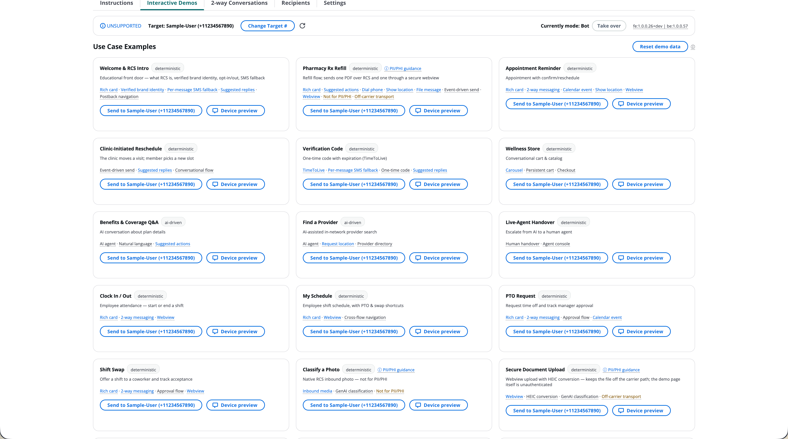

# AnyHealth RCS messaging demo

A deployable, end-to-end demo of Rich Communication Services (RCS) messaging with AWS End User Messaging, themed as a fictitious healthcare brand called AnyHealth. The demo has two parts: an AWS backend that you deploy into your own account with the AWS Cloud Development Kit (AWS CDK), and a web dashboard that runs on your local machine. You use the dashboard to register test devices, send any use case example to a selected device, and follow each conversation live. You can also take over as a human care advocate and converse over RCS with the target device.



> **Important:** This is sample code for demonstration purposes. It is not intended for production use. Deploy it into a sandbox or development account that you own, do not point it at real customer data, and run `cdk destroy` when you are done. See [LICENSE](LICENSE) (MIT-0), the [deployment checklist and deliberate security trade-offs](SECURITY.md#scope--read-this-before-deploying), the [HIPAA notice](#privacy-and-security), and [Cost](#cost).

## Quick start

[SETUP.md](SETUP.md) is the complete guide, and this outline uses its step numbers. You can run every step yourself, or have an AI coding assistant such as Kiro, Claude Code, or Cursor run steps 2 to 5 for you ([Set this up using an AI coding assistant](SETUP.md#set-this-up-using-an-ai-coding-assistant)). Run every command from the repository root. You should be familiar with AWS CDK and the basics of Amazon Simple Notification Service (Amazon SNS) and AWS Lambda.

**Before you start**, check the [prerequisites](SETUP.md#prerequisites): an AWS account that you own for sandbox or development work, AWS Command Line Interface (AWS CLI) v2 with the RCS commands, Amazon Bedrock access to the default model (the two AI use case examples and the photo descriptions need it; the rest of the demo works without it), Node.js 22 or later, `python3` with `pip` or Docker, and an RCS-capable test phone.

> **Check your [AWS End User Messaging RCS monthly spend limit](SETUP.md#rcs-monthly-spend-limit) first**, in the Region you plan to deploy to. The limit on a new account can be as low as $1 per month. To read it with the AWS CLI, run the following command, replacing `<REGION>` with that Region:
>
> ```bash
> aws pinpoint-sms-voice-v2 describe-spend-limits --region <REGION> \
>   --query "SpendLimits[?Name=='RCS_MESSAGE_MONTHLY_SPEND_LIMIT']"
> ```
>
> To read it in the console, open the [Service Quotas console](https://console.aws.amazon.com/servicequotas/home), choose **AWS services** in the navigation pane, choose **AWS End User Messaging SMS**, and open **RcsMessageMonthlySpend**. Its **applied quota value** is the `MaxLimit` that the command reports. If `MaxLimit` is 1, request an increase before you plan to send messages; the linked section of SETUP.md has the steps.

1. **[Configure your brand](SETUP.md#1-configure-your-brand-optional) (optional).** Skip this step (recommended). The demo ships with the fictitious AnyHealth brand in `content/brand.md` and `media/`, so you enter no brand details: step 2 registers a new RCS agent with it, and step 3 applies it to the messages and the dashboard. To use your own brand, follow [Editing the demo](#editing-the-demo) before proceeding to step 2.
2. **[Set up your RCS agent](SETUP.md#2-set-up-your-rcs-agent).** Create a new RCS testing agent (recommended). Paste the [prompt](SETUP.md#the-prompt) into your AI coding assistant, which follows [AGENTS.md](AGENTS.md), or run the same commands yourself in the order SETUP.md gives. A testing agent delivers only to test devices, so the setup adds your phone as one of those devices. It also saves the agent ID and Region in `.deploy/agent.json`, which step 3 reads/uses for the CDK deployment.

   - To reuse an RCS testing agent that already exists in your AWS account, see [Use an existing agent](SETUP.md#use-an-existing-agent). Reuse only an agent that no other work depends on, because the deploy repoints its two-way messaging ([Clean up](#clean-up)).
3. **[Deploy the infrastructure](SETUP.md#3-deploy-the-infrastructure).** `(cd cdk && npm ci && npx cdk bootstrap && npx cdk deploy)` creates the backend and connects it to your RCS agent. Note the `ApiUrl` and `ApiKeySecretName` outputs.
4. **[Retrieve the API key](SETUP.md#4-retrieve-the-api-key).** The dashboard needs the key for every route except the [open routes](SECURITY.md#open-routes). The `web/.env` command in step 5 of SETUP.md fetches the key without printing it, so you can skip printing it here.
5. **[Run the dashboard](SETUP.md#5-run-the-dashboard)** on your own machine with `(cd web && npm ci && npm run dev)`, open <http://localhost:5173>, and give it the `ApiUrl` and the key with `web/.env` or the **Settings** tab.

   > **Important:** Run the dashboard locally only. `npm run build` writes `VITE_API_KEY` into the JavaScript bundle in plaintext, so never host or share a `web/dist` build. See [Why the dashboard is local-only](SECURITY.md#why-the-dashboard-is-local-only).

6. **[Try the demo](SETUP.md#6-try-the-demo).** On the **Recipients** tab, wait for your phone to show `VERIFIED`, set it as the target, and send a use case example from Interactive Demos.

## What the demo shows

The demo ships 20 use case examples. Thirteen are customer/member-facing (one of them, Video Visit, is experimental and uses the Amazon Chime SDK) and four are staff self-service examples. The other three are experimental: the Camera & Mic Probe and two "Mystery Box" examples that embed video through Amazon Interactive Video Service (Amazon IVS). You can trigger any use case example from the dashboard to be sent to any verified target device. You can change the target device in the dashboard at any time, so you can demo with several devices. This is useful for seeing how Android and iOS differ slightly in presentation and UI.

The following tables list the RCS capabilities of AWS End User Messaging and the dashboard features, and where to find them in the use case examples.

### Messaging

| Capability | Where |
|---|---|
| Rich cards and all six suggestion types (`Reply`, `OpenUrl`, `DialPhone`, `ShowLocation`, `RequestLocation`, `CreateCalendarEvent`) | Across the examples, for instance Pharmacy Rx Refill, Appointment Reminder, PTO Request, and Find a Provider (`RequestLocation`) |
| Carousel | Wellness Store |
| Event-driven sends and inbound two-way routing | Pharmacy Rx Refill, Appointment Reminder |
| AI conversation with Amazon Bedrock, grounded on your content | Benefits & Coverage Q&A, Find a Provider |
| Verification code with expiration (`TimeToLive`), a messaging demo and not an authentication mechanism | Verification Code |
| Per-message SMS fallback (`FallbackConfiguration`), off by default | 13 of 20 use case examples; the **Settings** tab shows whether it is active |
| Live-agent handover from AI to human, with replies over RCS | **2-way Conversations** tab |
| Conversational cart and catalog with a persistent cart | Wellness Store |
| Internal staff self-service on the same channel | Clock In / Out, My Schedule, PTO Request, Shift Swap |
| Keywords and opt-outs. The service answers `HELP` and `STOP`, and you can add `OPT_IN`, `OPT_OUT`, and auto-reply keywords. | **Settings** tab, **Recipients** tab |

### Media, files, and webviews

| Capability | Where |
|---|---|
| PDF delivered into the thread as a `FileMessage` | Pharmacy Rx Refill (Rx Documents chip) |
| Carrier transport compared with webview transport: a generic PDF over RCS beside a PHI-shaped one served only through a webview | Pharmacy Rx Refill (Rx Documents chip; see [Pharmacy Rx refill](docs/architecture.md#42-pharmacy-rx-refill)) |
| Shared location (`RequestLocation`), where the handset answers with coordinates | Find a Provider |
| Inbound native RCS photo, converted with EXIF and HEIC awareness and classified by generative AI | Classify a Photo |
| Secure webview upload with a presigned Amazon Simple Storage Service (Amazon S3) PUT and HEIC-to-JPEG conversion | Secure Document Upload |
| Three-page sample loan agreement that can be initialed and signed in a webview by the recipient, with a signing receipt | Loan Agreement (e-sign) |
| In-message webviews (`WEBVIEW` suggestions) | Appointment Reminder, Pharmacy Rx Refill, My Schedule, Shift Swap, Secure Document Upload |
| Experimental: the Video Visit example embeds a WebRTC video call through the Amazon Chime SDK for JavaScript in the in-conversation webview | Video Visit (see [Video Visit](docs/architecture.md#414-video-visit--webrtc-in-the-webview-experimental)) |
| Experimental: hosted Amazon IVS demos opened as a top-level webview | **Settings**, Mystery Boxes (see [IVS webview experiments](docs/architecture.md#415-ivs-webview-experiments-icasino-interactive-fitness)) |
| Experimental: camera and microphone capability probe | **Settings**, Diagnostics & experiments |

### Dashboard

The dashboard is a local Cloudscape app in `web/` with five tabs and a status bar that appears on every tab. The following table summarizes each tab, the status bar, and the upload webview that opens from a message.

| Where | Capability |
|---|---|
| **Instructions** tab | An in-app walkthrough of the demo in seven sections: register a device, set the target, send a use case example, hold a conversation, hand over to a live agent, and choose between a carrier file and a webview. It shows your current device target. The last section explains what RCS can do, drawn from the RCS feature registry (`content/rcs-features.json`) with AWS documentation links. |
| **Interactive Demos** tab | The use case example catalog. Send any example to the target device, or use **Device preview** to preview a card's RCS content without sending it (the two AI examples generate their content per conversation, so they have nothing fixed to preview). Feature tags on each card explain what it demonstrates, with the documented limits and AWS documentation links, and the Classify a Photo, Secure Document Upload, and Pharmacy Rx Refill cards also link to PII/PHI guidance. The tab shows the latest photo a member sent with its generative AI classification (select it to enlarge). **Reset demo data** clears the conversation history and all generated media in S3. The Video Visit card also opens the clinician's side of the call, and **Video preview** shows the member's side in a phone frame, so you can test both ends without a handset. |
| **2-way Conversations** tab | A live transcript for each recipient. Take over as a human care advocate and reply over RCS, release the conversation back to the bot, inspect the raw RCS JSON of any message, and select a received photo to enlarge it. A red dot in the tab name shows that the target device's conversation is with a live agent. |
| **Recipients** tab | Where you manage test devices: register them (up to 10 per agent; the tab shows `n/10` and lets you remove one to make room), track verification status, and choose the target for sends. Per-recipient counts show sent, failed, and received messages. Delivered and read counts stay at zero on a testing agent (this sample received no delivery or read events from one, and it has not been tested with a country-launched agent). The fell-back-to-SMS count also stays at zero there, because it needs an SMS fallback number and fallback events ([Per-message SMS fallback](docs/architecture.md#per-message-sms-fallback)). The **Opt-out** column flags numbers on the account's Default opt-out list, which is where a test device that texted `stop` lands. The bot reads the same list before it answers, so an opted-out test device gets no replies ([Keywords, and where a keyword is answered](docs/architecture.md#21-keywords-and-where-a-keyword-is-answered)). A QR code shows the RCS agent's inbound deep link, which you create in the AWS console and paste into the tab (see [step 6](SETUP.md#6-try-the-demo)). |
| **Settings** tab | Connection and configuration. Enter the API URL and API key that connect the dashboard to your deployment. See the AWS account and Region the API runs in, plus the **Live agent identity** and **RCS agent registration** cards for your RCS agent. The tab shows whether SMS fallback is active or needs a redeploy with `-c smsFallbackNumber=+1…`. Add or delete `AUTOMATIC_RESPONSE`, `OPT_IN`, and `OPT_OUT` keywords, such as an `UNSTOP` opt-in; `HELP` and `STOP` are read-only ([Keyword replies](SETUP.md#keyword-replies) explains how the deploy sets their text). **Diagnostics & experiments** holds the Camera & Mic Probe and the two Amazon IVS experiments, each with a send control and a device preview. |
| Dashboard status bar (every tab) | Appears at the top of every tab. The target device picker, with an indicator of whether that device can receive; who is answering the conversation (bot or live agent), with a control to take over or release it; an account-level RCS spend and quota warning; the last error; a typing indicator (`RCS_TYPING` inbound events; not yet received in this sample's testing, see [Dashboard](docs/architecture.md#5-dashboard)); and the build versions (`fe:` and `be:`) from `version.json` plus a git commit count. |
| Upload webview (opened from a message) | A preview of the uploaded photo that enlarges when you select it. |

### Use case example catalog

**Customer / Member:** Welcome & RCS Intro, Pharmacy Rx Refill, Appointment Reminder, Clinic-Initiated Reschedule, Verification Code, Wellness Store, Benefits & Coverage Q&A (AI), Find a Provider (AI), Live-Agent Handover, Classify a Photo, Secure Document Upload, Loan Agreement (e-sign).

**Internal staff:** Clock In/Out, My Schedule, PTO Request, and Shift Swap. These use case examples run on the same RCS channel and read the employee profile, shifts, PTO balance, and coworkers from `content/workplace.md`.

**Experimental:** The Video Visit, Camera & Mic Probe and the two "Mystery Box" examples (both embed Amazon IVS in a webview) are experiments. Webview behavior varies by messaging app and device, so test them on your own handsets before you rely on them.

#### Notes on selected examples

- **Native photo and webview upload.** Classify a Photo and Secure Document Upload share one converter. The native path crosses the carrier network, so send a generic, non-sensitive (no PII, PHI) photo, and the upload page has no member sign-in, so use sample images only. See [Rich media: two ingress paths](docs/architecture.md#3-rich-media--two-ingress-paths).

## Architecture

If you are new to RCS, start with [docs/tutorial.md](docs/tutorial.md). It explains what RCS is, what `SendRcsMessage` can carry, and why this demo is shaped the way it is. The architecture document assumes you already have a working knowledge of RCS.

The following diagram shows the high-level architecture. [docs/architecture.md](docs/architecture.md) has diagrams of the comprehensive system architecture, the inbound-routing decision path, and the two rich-media ingress paths, plus a narration for every use case example and a flow diagram for most of them.


The numbers match the labels in the diagram.

1. A member or staff member sends a text, taps a suggestion chip, shares a location, or sends a photo to the RCS agent.
2. The RCS agent publishes inbound messages and suggestion taps to an Amazon SNS topic (two-way messaging). The configuration set's event destination publishes outbound status events, such as delivery and read, to the same topic.
3. SNS invokes the Channel Adapter Lambda function. Every conversation turn goes through this one function: the deterministic flows, keyword handling, and live-agent handover.
4. For the two AI use case examples, the adapter calls Amazon Bedrock, grounded on the `content/*.md` files.
5. The adapter reads and writes the transcript and the flow state in Amazon DynamoDB.
6. The adapter replies with `SendRcsMessage`, with an optional per-message SMS fallback.
7. The dashboard runs on your own machine and calls the HTTP API with the API key.
8. For the routes that need the key, a Lambda authorizer checks it before Amazon API Gateway routes the request to the Dashboard API function. The [open routes](SECURITY.md#open-routes) skip this check.
9. The Dashboard API function reads and writes the same DynamoDB table.
10. To send a use case example or a human reply, the Dashboard API function invokes the Channel Adapter asynchronously, so one code path builds and logs every message.

The `cdk deploy` command creates the storage, messaging, functions, API and two-way wiring, but not the RCS agent, which you set up in [step 2](SETUP.md#2-set-up-your-rcs-agent). [What the stack creates](docs/architecture.md#what-the-stack-creates) lists every resource, and [Rich media: two ingress paths](docs/architecture.md#3-rich-media--two-ingress-paths) covers the photo and upload paths that the diagram does not show.

## Clean up

Run `(cd cdk && npx cdk destroy)`, then delete the RCS agent in the order that [Teardown](SETUP.md#teardown) gives, unless you reused an agent that other work depends on.

> **Important:** The stack does not own your RCS agent. `cdk deploy` repoints the agent's two-way messaging at the stack, and `cdk destroy` turns it off instead of restoring the previous settings, so use a dedicated RCS agent.

## Cost

Demo-level usage costs roughly $15 to $25 per month, assuming the stack stays deployed all month and you send a modest number of messages. This is an order-of-magnitude estimate based on [AWS End User Messaging pricing](https://aws.amazon.com/end-user-messaging/pricing/) and the [AWS Pricing Calculator](https://calculator.aws/) as of September 2026. Your actual cost depends on Region, message volume, and usage. The estimate includes the fixed monthly costs described in this section and covers:

- RCS messages sent with AWS End User Messaging
- Amazon SNS
- The Channel Adapter, Dashboard API, media convert, and authorizer Lambda functions
- Amazon DynamoDB (on-demand, with a customer-managed AWS KMS key and point-in-time recovery)
- Amazon S3
- Amazon API Gateway
- Amazon Bedrock

The Video Visit use case example adds Amazon Chime SDK attendee-minutes, billed per attendee for each minute the attendee is connected to a meeting (see [Amazon Chime SDK pricing](https://aws.amazon.com/chime/chime-sdk/pricing/)). It is the one usage-based cost here that accrues with the time attendees spend in a call, not with the number of messages sent. A meeting is created when the first person joins and is deleted when the clinician, or the last remaining participant, leaves.

Messages to test devices are billed at standard RCS rates (see [Testing RCS messages](https://docs.aws.amazon.com/sms-voice/latest/userguide/rcs-testing.html)). RCS messages are billed only when delivered, so failed sends cost nothing, and inbound messages (taps and replies from the phone) are billed too. SMS, by contrast, is charged for requested messages. See [RCS billing and pricing model](https://docs.aws.amazon.com/sms-voice/latest/userguide/rcs-billing.html).

> **Registration fees are not in that figure.** AWS lists carrier pass-through charges for RCS agents (a one-time setup fee, an annual brand vetting fee, and a monthly maintenance fee) as separate line items, excluded from Enterprise Discount Program (EDP) discounts. Check the [RCS pricing](https://aws.amazon.com/end-user-messaging/pricing/) page for your country before you create the agent, and review your bill afterward.

> **RCS monthly spend limit.** A new account is often limited to $1 of RCS messages per month, which allows a few dozen messages. The value varies by account and Region, so check yours first ([RCS monthly spend limit](SETUP.md#rcs-monthly-spend-limit)).

> **Fixed monthly costs.** These accrue whether or not you send anything. They include one customer-managed AWS KMS key for the table (about $1 per month), the API-key secret in AWS Secrets Manager (about $0.40 per month, see [AWS Secrets Manager pricing](https://aws.amazon.com/secrets-manager/pricing/)), DynamoDB point-in-time recovery, S3 versioning and S3 access logs, and Amazon CloudWatch Logs, including the API access log. Run `cdk destroy` when you are done instead of leaving the stack up.

## Privacy and security

> AnyHealth is not a real company. All plan details, providers, prices, staff rosters, and products are illustrative sample data that you can replace; see [Editing the demo](#editing-the-demo), which also covers the registered RCS agent identity.

> **HIPAA notice:** `content/benefits.md` contains healthcare-shaped sample data (deductibles, copays, mental health coverage) for demonstration only. It is not real member information. This demo is **not** a system that complies with the Health Insurance Portability and Accountability Act (HIPAA). If you adapt it to handle real protected health information (PHI), you are responsible for implementing controls beyond what this demo provides. These include an AWS Business Associate Addendum (BAA), encryption at rest and in transit, audit logging, access controls, and data retention. See [AWS HIPAA compliance](https://aws.amazon.com/compliance/hipaa-compliance/) for guidance, and the [HIPAA Eligible Services Reference](https://aws.amazon.com/compliance/hipaa-eligible-services-reference/) for the services in this stack.

> **Security notice:** The dashboard API is lightweight demo infrastructure. A shared API key, checked by a Lambda authorizer, gates every route except the few that are open on purpose. A shared key is not a substitute for a real identity provider. SECURITY.md lists the [open routes](SECURITY.md#open-routes), the [routes that need the key](SECURITY.md#routes-that-need-the-api-key), the API access log, and what to change before you adapt this sample.

<a id="editing-the-demo"></a>
## Editing the demo (optional)

| File | Controls |
|---|---|
| `content/brand.md` | Brand name, colors, contact information, member profile, and the registration field values that the RCS agent setup reads once ([step 2](SETUP.md#2-set-up-your-rcs-agent)) |
| `content/benefits.md` | Knowledge for the Benefits & Coverage Q&A assistant |
| `content/providers.md` | Directory for the Find a Provider assistant |
| `content/store.md` | Wellness Store product catalog (cart use case example) |
| `content/workplace.md` | Employee profile, shifts, PTO balance, and coworkers (internal use case examples) |
| `media/` | Logo (224×224), banner (1440×448), card and product images, and the generic PDF that the demo sends as a file message |
| `secure-docs/` | Documents served only through a webview, never as a file message ([Pharmacy Rx refill](docs/architecture.md#42-pharmacy-rx-refill)). Regenerate both sample PDFs with `python3 scripts/gen-sample-pdfs.py`. |
| `lambda/flows/*.py` | Card text and sample data of the scripted use case examples (for example the Rx refill, appointment, and video visit cards) |
| `content/rcs-features.json` | RCS limits and feature descriptions that the send-path validator and the dashboard tooltips read; see [docs/updating-rcs-content.md](docs/updating-rcs-content.md) |
| `lambda/webviews/*.html` | In-message webview pages (brand tokens substituted at serve time) |

The brand name also drives the resource-name prefix and the stack name (`<prefix>-rcs-demo`). The deploy stages `content/*.md` and `content/rcs-features.json` into the Lambda assets at synth. Change a file and redeploy with `cdk deploy`, and the change reaches the Lambda functions, the webviews, and the dashboard. It does not reach the registered agent identity (logo, banner, display name, colors, and contact details): the stack has no registration resource, and the registration was submitted during RCS agent setup ([step 2](SETUP.md#2-set-up-your-rcs-agent)). Some registered brand assets cannot be changed after the registration is submitted, and updates to others are reviewed before they appear on handsets ([Managing RCS agents](https://docs.aws.amazon.com/sms-voice/latest/userguide/rcs-agents.html)), so settle the logo, banner, and display name first.

> **Important:** Do not change `brandName` on an existing deployment. The prefix is a slug of the brand name (lowercased, each run of other characters replaced by `-`, leading and trailing `-` removed, cut to 20 characters; `anyhealth` if nothing is left). A change that alters the slug makes `cdk deploy` create a second stack beside the first, with a new table, buckets, AWS Key Management Service (AWS KMS) key, secret, and API, instead of updating it. The new stack repoints the shared agent's two-way messaging at its own Amazon SNS topic, so the old stack stops receiving inbound messages. Destroying the old stack afterward leaves that setting in place (see [Teardown](SETUP.md#teardown)). To deploy under a different brand name, run `cdk destroy` on the existing stack first.

## Contributing

See [CONTRIBUTING.md](CONTRIBUTING.md). This project has adopted a [Code of Conduct](CODE_OF_CONDUCT.md). To report a security issue, follow [SECURITY.md](SECURITY.md). Do not open a public issue for one.

## License

This project is licensed under the MIT-0 License. See [LICENSE](LICENSE) and [NOTICE](NOTICE).

The vendored Amazon Chime SDK bundle (`lambda/webviews/chime-sdk.js`) is not MIT-0. It contains Amazon Chime SDK code and third-party code under other licenses. See [NOTICE](NOTICE) and [`lambda/webviews/chime-sdk.LICENSES.txt`](lambda/webviews/chime-sdk.LICENSES.txt).

## Attribution

The RCS agent setup workflow in [AGENTS.md](AGENTS.md) is adapted from [`aws-samples/sample-rcs-agent-setup-and-send-messages`](https://github.com/aws-samples/sample-rcs-agent-setup-and-send-messages) (MIT-0). The content was rephrased and adapted for this demo. See [NOTICE](NOTICE).
