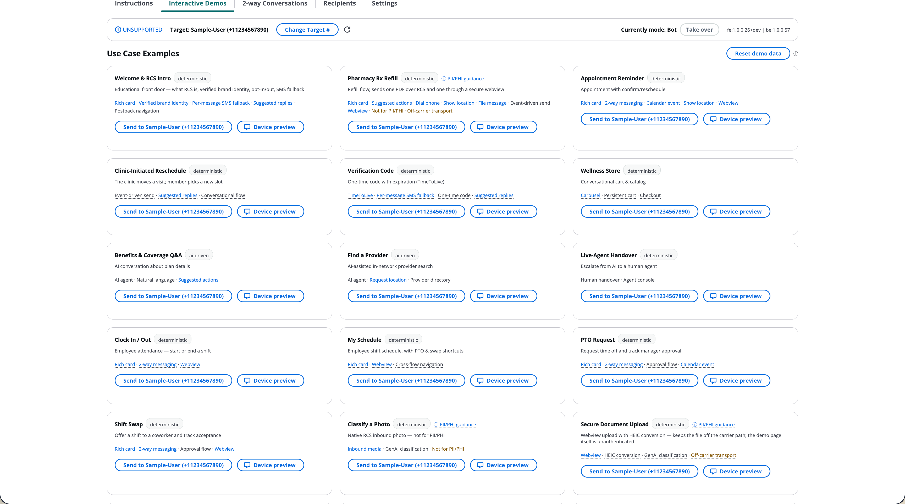

# AWS End User Messaging RCS Demo Catalog

A deployable, end-to-end demo of Rich Communication Services (RCS) messaging with AWS End User Messaging. It ships with a catalog of independent, fictitious brands covering various industries and use cases. This version includes:

- **AnyHealth** (`anyhealth`): healthcare
- **AnyTravel** (`anytravel`): travel and hospitality
- **AnyWealth** (`anywealth`): financial services
- **AnyHR** (`anyhr`): HR and workforce self-service
- **AnyBuild** (`anybuild`): residential construction

You deploy any one or more of them. The brands are unrelated siblings; none is a parent or umbrella over the others. Each brand is its own stack with its own RCS agent, and shows its own verified sender identity on the handset. The catalog lives in `content/brand.md`, so more brands can be added there.

You pick the brands when you deploy, by id or `all`. The local dashboard shows one brand at a time, with only that brand's vignettes, and a brand picker switches between the brands you deployed. The screenshot below shows AnyHealth.

The demo has two parts: an AWS backend that you deploy into your own account with the AWS Cloud Development Kit (AWS CDK), and a web dashboard that runs on your local machine. You use the dashboard to register test devices, send any use case example to a selected device, and follow each conversation live. You can also take over as a human advocate and converse over RCS with the target device.



> **Important:** This is sample code for demonstration purposes. It is not intended for production use. Deploy it into a sandbox or development account that you own, do not point it at real customer data, and run `cdk destroy` when you are done. See [LICENSE](LICENSE) (MIT-0), the [deployment checklist and deliberate security trade-offs](SECURITY.md#scope--read-this-before-deploying), the [HIPAA notice](#privacy-and-security), and [Cost](#cost).

## Quick start

Clone the repository, open a terminal in its folder, and run every command from there. You should be familiar with AWS CDK and the basics of Amazon Simple Notification Service (Amazon SNS) and AWS Lambda. There are two ways to deploy, and both deploy one brand or several:

- **One command.** `(cd cdk && npm ci)`, then `node scripts/deploy.mjs --region <REGION> --phone <your E.164 number>`. It asks which brands you want (or pass `--brands anyhealth,anybuild` or `--brands all`). It then runs pre-flight checks, shows one plan of everything it will create or change, including IAM changes, and waits for you to type `deploy`. See [Deploy one or more brands](SETUP.md#deploy-one-or-more-brands).
- **An AI coding assistant** such as Kiro, Claude Code, or Cursor. Paste the [prompt](SETUP.md#the-prompt), naming the brands you want. The assistant follows [AGENTS.md](AGENTS.md) and runs the same script, showing you the plan before anything is created ([Set this up using an AI coding assistant](SETUP.md#set-this-up-using-an-ai-coding-assistant)).

Pre-flight checks the following before anything is created, and reports every blocker for every brand at once with how to fix it:

- your credentials, the AWS CLI, Node.js, and python3 or Docker
- the account's RCS agent quota and the RCS spend limit
- whether CDK is bootstrapped in the Region
- each brand's registration values
- whether each brand already has an agent or a stack

The deploy then runs one brand after another. A brand that fails is skipped, and the summary says which step failed, why, what already exists, and the command that resumes it. [SETUP.md](SETUP.md) also walks through every step by hand; the outline below uses its step numbers.

**Before you start**, check the [prerequisites](SETUP.md#prerequisites): an AWS account that you own for sandbox or development work, AWS Command Line Interface (AWS CLI) v2 with the RCS commands, Amazon Bedrock access to the default model (the AI use case examples, which are each brand's assistant, AnyHealth's Find a Provider and AnyTravel's Room Booking, plus the typed answers in seven examples and the photo descriptions, need it; the rest of the demo works without it), Node.js 22 or later, `python3` with `pip` or Docker, and an RCS-capable test phone.

> **Check your [AWS End User Messaging RCS monthly spend limit](SETUP.md#rcs-monthly-spend-limit) first**, in the Region you plan to deploy to. The limit on a new account can be as low as $1 per month. To read it with the AWS CLI, run the following command, replacing `<REGION>` with that Region:
>
> ```bash
> aws pinpoint-sms-voice-v2 describe-spend-limits --region <REGION> \
>   --query "SpendLimits[?Name=='RCS_MESSAGE_MONTHLY_SPEND_LIMIT']"
> ```
>
> To read it in the console, open the [Service Quotas console](https://console.aws.amazon.com/servicequotas/home), choose **AWS services** in the navigation pane, choose **AWS End User Messaging SMS**, and open **RcsMessageMonthlySpend**. Its **applied quota value** is the `MaxLimit` that the command reports. If `MaxLimit` is 1, request an increase before you plan to send messages; the linked section of SETUP.md has the steps.

`scripts/deploy.mjs` does steps 2, 3 and 4, and the wiring part of step 5, for every brand you pick. The steps below are what it does, and how to do each one by hand.

1. **[Configure your brand](SETUP.md#1-configure-your-brand-optional) (optional).** You can skip this step (recommended). The demo ships complete, fictitious brands in `content/brand.md`'s brands catalog, each with its own art under `media/<id>/`. Choosing brands is a selection at deploy time, not an edit: step 2 registers a new RCS agent for each brand you pick, and step 3 applies that brand to its messages and its dashboard view. To re-theme a brand, edit its block in `content/brand.md`; see [Editing the demo](#editing-the-demo) before proceeding to step 2.
2. **[Set up your RCS agent](SETUP.md#2-set-up-your-rcs-agent).** Create a new RCS testing agent (recommended) for each brand you deploy. Paste the [prompt](SETUP.md#the-prompt) into your AI coding assistant, which follows [AGENTS.md](AGENTS.md), run `node scripts/create-agent.mjs <id> <REGION> --phone <your number>`, which does the whole step in one command after checking your account's RCS agent quota and the brand's registration values, or run the same AWS CLI commands yourself in the order SETUP.md gives. The setup registers one agent from the selected brand's identity block. A testing agent delivers only to test devices, so the setup adds your phone as one of those devices (up to ten per agent, each by a separate invitation you accept on the handset). It also records the agent ID and Region for that brand in `.deploy/agent.json`, which step 3 reads for the CDK deployment and checks against the brand before it deploys.

   - To reuse an RCS testing agent that already exists in your AWS account, see [Use an existing agent](SETUP.md#use-an-existing-agent). Reuse only an agent that no other work depends on, because the deploy repoints its two-way messaging ([Clean up](#clean-up)).
3. **[Deploy the infrastructure](SETUP.md#3-deploy-the-infrastructure).** `(cd cdk && npm ci && npx cdk bootstrap -c brand=<id> && npx cdk deploy -c brand=<id>)` creates the backend for the selected brand and connects it to your RCS agent. Leave off `-c brand=<id>` to deploy `anyhealth`, and pass the same `-c brand=<id>` you used when you set the agent up. Note the `ApiUrl` and `ApiKeySecretName` outputs.
4. **[Retrieve the API key](SETUP.md#4-retrieve-the-api-key).** The dashboard needs the key for every route except the [open routes](SECURITY.md#open-routes). The `web/.env` command in step 5 of SETUP.md fetches the key without printing it, so you can skip printing it here.
5. **[Run the dashboard](SETUP.md#5-run-the-dashboard)** on your own machine with `(cd web && npm ci && npm run dev)`, open <http://localhost:5173>, and give it the `ApiUrl` and the key with `web/.env` or the **Settings** tab. One local dashboard on one port serves every brand you have wired up: a brand picker in the top navigation switches between them, and it appears only when two or more brands are wired and usable. To add a brand, run `node scripts/wire-dashboard-brand.mjs <Brand_Id> <REGION>` once after its stack is deployed, and `node scripts/wire-dashboard-brand.mjs --remove <Brand_Id>` after you tear one down. See [Running more than one brand](SETUP.md#running-more-than-one-brand).

   > **Important:** Run the dashboard locally only. `npm run build` writes `VITE_API_KEY` into the JavaScript bundle in plaintext, so never host or share a `web/dist` build. See [Why the dashboard is local-only](SECURITY.md#why-the-dashboard-is-local-only).

6. **[Try the demo](SETUP.md#6-try-the-demo).** On the **Recipients** tab, wait for your phone to show `VERIFIED`, set it as the target, and send a use case example from Interactive Demos.

## What the demo shows

The demo ships use case examples across all the brands in the catalog, and each one belongs to exactly one brand. The dashboard shows only the selected brand's examples, so what you see depends on the brands you deployed and the one you pick in the dashboard. Most of the examples belong to AnyHealth: twelve customer/member-facing (one of them, Video Visit, is experimental and uses the Amazon Chime SDK), plus three experimental ones — the Camera & Mic Probe and two "Mystery Box" examples that embed video through Amazon Interactive Video Service (Amazon IVS). The four staff self-service examples (Clock In/Out, My Schedule, PTO Request, Shift Swap) belong to AnyHR. AnyTravel adds three hotel examples (Room Booking, Express Check-In, Travel Offers) and four airline examples (Flight Check-In, Flight Status Alert, Disruption Rebooking, Bag Tracking), and AnyWealth adds a verified-sender fraud alert and the Loan Agreement (e-sign) example. AnyBuild adds nine examples for builders, suppliers and trades: a welcome for each app side, Site Evidence, Identity Capture, Arrival Alert, Delivery Location, Field Schedule, Job Readiness, and Agreement/Waiver, a sample agreement and waiver signed in the same kind of read-and-sign webview as AnyWealth's Loan Agreement. AnyTravel, AnyWealth, AnyHR and AnyBuild each also have an AI assistant grounded on the brand's content. You can trigger any of the selected brand's examples from the dashboard to be sent to any verified target device. You can change the target device in the dashboard at any time, so you can demo with several devices. This is useful for seeing how Android and iOS differ slightly in presentation and UI.

The following tables list the RCS capabilities of AWS End User Messaging and the dashboard features, and where to find them in the use case examples. They draw on examples from across the brands; which ones appear in your dashboard depends on the brand you deployed.

### Messaging

| Capability | Where |
|---|---|
| Rich cards and all six suggestion types (`Reply`, `OpenUrl`, `DialPhone`, `ShowLocation`, `RequestLocation`, `CreateCalendarEvent`) | Across the examples, for instance Pharmacy Rx Refill, Appointment Reminder, PTO Request, and Find a Provider (`RequestLocation`) |
| Carousel | Wellness Store, Travel Offers, Room Booking, Disruption Rebooking |
| Event-driven sends and inbound two-way routing | Pharmacy Rx Refill, Appointment Reminder |
| A location event in your own system becomes a message. RCS has no geofencing, so your system detects the fence and calls the send; the dashboard's Send button stands in for it | Arrival Alert |
| AI conversation with Amazon Bedrock, grounded on your content | Benefits & Coverage Q&A, Find a Provider, Room Booking, and the AnyTravel, AnyWealth, AnyHR and AnyBuild assistants |
| A typed reply read by AI, checked in code, then handled like the matching chip | Disruption Rebooking, Bag Tracking, PTO Request, Field Schedule, Job Readiness, Site Evidence, Delivery Location |
| Verification code with expiration (`TimeToLive`), a messaging demo and not an authentication mechanism | Verification Code, Fraud Alert, Flight Status Alert |
| Per-message SMS fallback (`FallbackConfiguration`), off by default | 29 of 41 use case examples; the **Settings** tab shows whether it is active |
| Live-agent handover from AI to human, with replies over RCS | **2-way Conversations** tab |
| Conversational cart and catalog with a persistent cart | Wellness Store |
| Internal staff self-service on the same channel | Clock In / Out, My Schedule, PTO Request, Shift Swap, Field Schedule, Job Readiness |
| Keywords and opt-outs. The service answers `HELP` and `STOP`, and you can add `OPT_IN`, `OPT_OUT`, and auto-reply keywords. | **Settings** tab, **Recipients** tab |

### Media, files, and webviews

| Capability | Where |
|---|---|
| PDF delivered into the thread as a `FileMessage` | Pharmacy Rx Refill (Rx Documents chip) |
| Carrier transport compared with webview transport: a generic PDF over RCS beside a PHI-shaped one served only through a webview | Pharmacy Rx Refill (Rx Documents chip; see [Pharmacy Rx refill](docs/architecture.md#42-pharmacy-rx-refill)) |
| Shared location (`RequestLocation`), where the handset answers with coordinates | Find a Provider, Delivery Location (the reply moves a map pin) |
| Inbound native RCS photo, converted with EXIF and HEIC awareness and classified by generative AI | Classify a Photo |
| Inbound photo or short video logged against a ticket. A photo is described by generative AI; a video is accepted by the service but receipted without a preview or description, because the converter handles images only | Site Evidence |
| Secure webview upload with a presigned Amazon Simple Storage Service (Amazon S3) PUT and HEIC-to-JPEG conversion | Secure Document Upload |
| Identity document capture: the card asks for the ID type, a passport (front only) or a USA driver's license (front and back), and a webview page captures one or two sides. The page shows what the document is and never the image; the dashboard's Identity Capture card shows the operator the captured sides. The document is not verified | Identity Capture |
| Three-page sample document (a loan agreement, or an agreement and waiver) that can be initialed and signed in a webview by the recipient, with a signing receipt | Loan Agreement (e-sign), Agreement/Waiver |
| In-message webviews (`WEBVIEW` suggestions) | Appointment Reminder, Pharmacy Rx Refill, Clock In/Out, My Schedule, Shift Swap, Secure Document Upload, Loan Agreement, Express Check-In (digital key), Flight Check-In (boarding pass), Identity Capture, Agreement/Waiver |
| Experimental: the Video Visit example embeds a WebRTC video call through the Amazon Chime SDK for JavaScript in the in-conversation webview | Video Visit (see [Video Visit](docs/architecture.md#414-video-visit--webrtc-in-the-webview-experimental)) |
| Experimental: hosted Amazon IVS demos opened as a top-level webview | **Settings**, Mystery Boxes (see [IVS webview experiments](docs/architecture.md#415-ivs-webview-experiments-icasino-interactive-fitness)) |
| Experimental: camera and microphone capability probe | **Settings**, Diagnostics & experiments |

### Dashboard

The dashboard is a local Cloudscape app in `web/` with five tabs and a status bar that appears on every tab. The following table summarizes each tab, the status bar, and the upload webview that opens from a message.

| Where | Capability |
|---|---|
| **Instructions** tab | An in-app walkthrough of the demo in seven sections: register a device, set the target, send a use case example, hold a conversation, hand over to a live agent, and choose between a carrier file and a webview. It shows your current device target. The last section explains what RCS can do, drawn from the RCS feature registry (`content/rcs-features.json`) with AWS documentation links. |
| **Interactive Demos** tab | The use case example catalog. Send any example to the target device, or use **Device preview** to preview a card's RCS content without sending it (the AI examples generate their content per conversation, so they have nothing fixed to preview). Feature tags on each card explain what it demonstrates, with the documented limits and AWS documentation links, and the Classify a Photo, Secure Document Upload, and Pharmacy Rx Refill cards also link to PII/PHI guidance. The tab shows the latest photo a member sent with its generative AI classification (select it to enlarge). **Reset demo data** clears the conversation history and all generated media in S3. The Video Visit card also opens the clinician's side of the call, and **Video preview** shows the member's side in a phone frame, so you can test both ends without a handset. |
| **2-way Conversations** tab | A live transcript for each recipient. Take over as the brand's live agent (its `liveAgentRole`, such as a care advocate or a booking concierge) and reply over RCS, release the conversation back to the bot, inspect the raw RCS JSON of any message, and select a received photo to enlarge it. A red dot in the tab name shows that the target device's conversation is with a live agent. |
| **Recipients** tab | Where you manage test devices: register them (up to 10 per agent; the tab shows `n/10` and lets you remove one to make room), track verification status, and choose the target for sends. Per-recipient counts show sent, failed, and received messages. Delivered, read and failed counts come from the configuration set's RCS, SMS and MMS status events, which arrive within seconds on a testing agent too (read needs the recipient to open the message, and some clients never report it). The fell-back-to-SMS count needs an SMS fallback number ([Per-message SMS fallback](docs/architecture.md#per-message-sms-fallback)). The **Opt-out** column flags numbers on the account's Default opt-out list, which is where a test device that texted `stop` lands. The bot reads the same list before it answers, so an opted-out test device gets no replies ([Keywords, and where a keyword is answered](docs/architecture.md#21-keywords-and-where-a-keyword-is-answered)). A QR code shows the RCS agent's inbound deep link, which you create in the AWS console and paste into the tab (see [step 6](SETUP.md#6-try-the-demo)). |
| **Settings** tab | Connection and configuration. Enter the API URL and API key that connect the dashboard to your deployment. See the AWS account and Region the API runs in, plus the **Live agent identity** and **RCS agent registration** cards for your RCS agent. The tab shows whether SMS fallback is active or needs a redeploy with `-c smsFallbackNumber=+1…`. Add or delete `AUTOMATIC_RESPONSE`, `OPT_IN`, and `OPT_OUT` keywords, such as an `UNSTOP` opt-in; `HELP` and `STOP` are read-only ([Keyword replies](SETUP.md#keyword-replies) explains how the deploy sets their text). **Diagnostics & experiments** holds the Camera & Mic Probe and the two Amazon IVS experiments, each with a send control and a device preview. |
| Brand picker (top navigation) | Appears when two or more brands are wired and usable. The dashboard lists a brand only if it can load that brand's agent identity (a live stack, a working API key and a registered RCS agent), and it opens on one that can. A brand that fails that check is left out without comment, and the dashboard looks again when you return to the tab. If brands are wired but none answers, a short screen with a **Retry** button replaces the dashboard. |
| Dashboard status bar (every tab) | Appears at the top of every tab. The target device picker, with an indicator of whether that device can receive; who is answering the conversation (bot or live agent), with a control to take over or release it; an account-level RCS spend and quota warning; the last error; a typing indicator (`RCS_TYPING` inbound events; not yet received in this sample's testing, see [Dashboard](docs/architecture.md#5-dashboard)); and the build versions (`fe:` and `be:`) from `version.json` plus a git commit count. |
| Upload webview (opened from a message) | A preview of the uploaded photo that enlarges when you select it. |

### Use case example catalog

Each example belongs to one brand, and the dashboard lists only the selected brand's examples.

**AnyHealth — customer / member:** Welcome & RCS Intro, Pharmacy Rx Refill, Appointment Reminder, Clinic-Initiated Reschedule, Verification Code, Wellness Store, Benefits & Coverage Q&A (AI), Find a Provider (AI), Live-Agent Handover, Classify a Photo, Secure Document Upload.

**AnyHR — workforce self-service:** Clock In/Out, My Schedule, PTO Request, and Shift Swap. These examples run on the same RCS channel and read the employee profile, shifts, PTO balance, and coworkers from `content/workplace.md`, which describes a fictitious retail employer, Maple Street Market. Shift dates are offsets from today (`dayOffset`), so the sample schedule is always upcoming.

**AnyTravel and AnyWealth:** AnyTravel covers the whole trip under one verified sender: four airline examples grounded on `content/flights.md` and three hotel examples grounded on `content/hotels.md`. Flight Check-In checks the traveler in, offers a seat change, and opens a sample boarding pass in a webview with an **Add to Calendar** chip. Flight Status Alert is a gate change and delay with a short `TimeToLive`, an airport map and a call chip. Disruption Rebooking follows a cancellation with a carousel of the next flights; an option that leaves tomorrow offers **Book a Hotel Tonight**, which hands off to Room Booking with the airport hotel and tonight's dates filled in. Bag Tracking reports a delayed bag and delivers it to the hotel or to a location the traveler shares. Room Booking is an AI-driven booking assistant that presents each property as one card with its photo and an **Open Map** chip, shows the room types as a carousel with one card per room (photo, occupancy and that property's nightly rate) where **Choose** answers with the room's second photo, takes its prices and the booking confirmation from the `rates` in `content/hotels.md` rather than from the model, and a typed "yes, confirm it" works the same as tapping **Confirm Booking**. Express Check-In is a check-in reminder with a chip for every room upgrade, the check-in and checkout times from `content/hotels.md`, and an **Open Door** chip that opens a demo digital key webview. Travel Offers opens with a short welcome (`offersIntro` in `content/hotels.md`), then a carousel of event-tied stays whose offer details carry into the booking. AnyWealth adds a verified-sender fraud alert (an expiring code with "Yes/No it was me" replies, grounded on `content/wealth.md`) and the Loan Agreement (e-sign) example. These show why each brand needs its own agent: the handset renders the brand's own verified sender identity.

**AnyBuild — residential construction field messaging:** grounded on `content/construction.md`, which describes a fictitious builder, Quillfeather Homes, its supplier Brindlewood Supply Co., and one jobsite. Every example is transactional. Hello: Builder App and Hello: Supplier App are short welcomes that say who is writing, what to expect and how to opt out. Site Evidence takes a photo or short video as an inspection record, proof that work is ready, or a damaged-delivery report that is routed to the supplier; photos are described by GenAI, and video is receipted without a description. The dashboard's Site Evidence card shows the latest ticket's items: each photo with its description, and each video or file without a preview. Identity Capture photographs a driver's license or passport on a secure webview page, so the image never crosses the carrier network (the demo does not verify the document). Arrival Alert turns a geofence event into a message with one-tap Gate Open or Hold; the geofence itself is detected by your own system, not by RCS, and the dashboard's Send button stands in for it. Delivery Location shows where a load was left as a map pin with a photo, and either side corrects it by sharing a location. Field Schedule publishes tomorrow's crew plan with confirm, can't-make-it and a roll call. Job Readiness shows dependencies between trades: marking the lower cabinets done clears the countertop crew, who accept, propose a date or push back with a reason. Agreement/Waiver sends a sample three-page agreement and waiver (assumption of risk, waiver and release, responsibilities) to initial and sign in a webview, the same pattern as AnyWealth's Loan Agreement.

**Brand assistants and typed answers:** AnyTravel, AnyWealth, AnyHR and AnyBuild each have an assistant on the home menu (Ask About My Trip, Ask About My Account, Ask HR, Ask About the Site) that also answers any typed question no example claims. It answers from the brand's content, quoting the same flights, charges, shifts and crew plan the cards show, and it does not act: when you want to do something it offers that example's home menu tile as a chip. Seven deterministic examples also accept a typed reply in place of a tap, for example "I need to land before noon" in Disruption Rebooking or "can't make it, my truck's in the shop" in Field Schedule. The model only reads the reply into a few fields; the code checks them and then does what the matching chip does, and if the model is unavailable the chips are shown again. See [Brand assistants and typed answers](docs/architecture.md#418-brand-assistants-and-typed-answers-ai).

**Experimental (AnyHealth):** The Video Visit, Camera & Mic Probe and the two "Mystery Box" examples (both embed Amazon IVS in a webview) are experiments. Webview behavior varies by messaging app and device, so test them on your own handsets before you rely on them.

#### Notes on selected examples

- **Home menu and Start Over.** On first contact (a greeting, the deep-link keyword, or `Start: Welcome`) every brand answers with a three-card welcome that ends in its own home menu tiles, from the `homeMenu` list in `content/brand.md`: eight for AnyHealth, eight for AnyTravel (the hotel and airline examples and Ask About My Trip), Fraud Alert, Loan Agreement and Ask About My Account for AnyWealth, Clock In / Out, My Schedule, Request PTO, Swap a Shift and Ask HR for AnyHR, and ten for AnyBuild (the two app welcomes, Site Evidence, Verify Identity, Arrival Alert, Delivery Location, Field Schedule, Job Readiness, Agreement/Waiver and Ask About the Site). Every bot message after that ends with a **Start Over** chip, except the home menu and the live-agent handover cards. Tapping it, or typing `menu`, `main menu`, `home`, `start over`, `reset` or `restart` as the whole message, resets the conversation from any example, including a live-agent handover, and sends one short home menu card. A Reset clears the current example, the cart, pending requests, codes and uploads, and the AI assistant's memory of earlier turns. It keeps a clocked-in shift, the latest photo, and the transcript. See [SETUP.md step 6](SETUP.md#6-try-the-demo).
- **Native photo and webview upload.** Classify a Photo and Secure Document Upload share one converter. The native path crosses the carrier network, so send a generic, non-sensitive (no PII, PHI) photo, and the upload page has no member sign-in, so use sample images only. See [Rich media: two ingress paths](docs/architecture.md#3-rich-media--two-ingress-paths).
- **Each deploy opens only its own brand's examples.** A `Start:` trigger, home tile, typed request, stale chip or shared location that belongs to another brand lands on the selected brand's short home menu. Typed text that matches nothing goes to the brand's AI assistant: Benefits & Coverage Q&A for AnyHealth, and the brand's own [assistant](docs/architecture.md#418-brand-assistants-and-typed-answers-ai) for the others. See [Brand isolation](docs/architecture.md#24-brand-isolation-a-deploy-opens-only-its-own-vignettes).

## Architecture

If you are new to RCS, start with [docs/tutorial.md](docs/tutorial.md). It explains what RCS is, what `SendRcsMessage` can carry, and why this demo is shaped the way it is. The architecture document assumes you already have a working knowledge of RCS.

The following diagram shows the high-level architecture. [docs/architecture.md](docs/architecture.md) has diagrams of the comprehensive system architecture, the inbound-routing decision path, and the two rich-media ingress paths, plus a narration for every use case example and a flow diagram for most of them.


The numbers match the labels in the diagram.

1. A member or staff member sends a text, taps a suggestion chip, shares a location, or sends a photo to the RCS agent.
2. The RCS agent publishes inbound messages and suggestion taps to an Amazon SNS topic (two-way messaging). The configuration set's event destination publishes outbound status events, such as delivery and read, to the same topic.
3. SNS invokes the Channel Adapter Lambda function. Every conversation turn goes through this one function: the deterministic flows, keyword handling, and live-agent handover.
4. For the AI use case examples (Benefits & Coverage Q&A, Find a Provider, Room Booking and the brand assistants) and for a typed answer in a deterministic example, the adapter calls Amazon Bedrock, grounded on the `content/*.md` files.
5. The adapter reads and writes the transcript and the flow state in Amazon DynamoDB.
6. The adapter replies with `SendRcsMessage`, with an optional per-message SMS fallback.
7. The dashboard runs on your own machine and calls the HTTP API with the API key.
8. For the routes that need the key, a Lambda authorizer checks it before Amazon API Gateway routes the request to the Dashboard API function. The [open routes](SECURITY.md#open-routes) skip this check.
9. The Dashboard API function reads and writes the same DynamoDB table.
10. To send a use case example or a human reply, the Dashboard API function invokes the Channel Adapter asynchronously, so one code path builds and logs every message.

The `cdk deploy` command creates the storage, messaging, functions, API and two-way wiring, but not the RCS agent, which you set up in [step 2](SETUP.md#2-set-up-your-rcs-agent). [What the stack creates](docs/architecture.md#what-the-stack-creates) lists every resource, and [Rich media: two ingress paths](docs/architecture.md#3-rich-media--two-ingress-paths) covers the photo and upload paths that the diagram does not show.

## Clean up

For each brand you deployed, run `(cd cdk && npx cdk destroy -c brand=<brand>)`, then `node scripts/wire-dashboard-brand.mjs --remove <brand>` to take the brand off the dashboard, then delete the RCS agent with `node scripts/delete-agent.mjs <brand> <REGION>` ([Teardown](SETUP.md#teardown)), unless you reused an agent that other work depends on.

> **Important:** The stack does not own your RCS agent. `cdk deploy` repoints the agent's two-way messaging at the stack, and `cdk destroy` turns it off instead of restoring the previous settings, so use a dedicated RCS agent.

## Cost

Demo-level usage costs roughly $15 to $25 per month, assuming the stack stays deployed all month and you send a modest number of messages. This is an order-of-magnitude estimate based on [AWS End User Messaging pricing](https://aws.amazon.com/end-user-messaging/pricing/) and the [AWS Pricing Calculator](https://calculator.aws/) as of September 2026. Your actual cost depends on Region, message volume, and usage. The estimate includes the fixed monthly costs described in this section and covers:

- RCS messages sent with AWS End User Messaging
- Amazon SNS
- The Channel Adapter, Dashboard API, media convert, and authorizer Lambda functions
- Amazon DynamoDB (on-demand, with a customer-managed AWS KMS key and point-in-time recovery)
- Amazon S3
- Amazon API Gateway
- Amazon Bedrock

The Video Visit use case example adds Amazon Chime SDK attendee-minutes, billed per attendee for each minute the attendee is connected to a meeting (see [Amazon Chime SDK pricing](https://aws.amazon.com/chime/chime-sdk/pricing/)). It is the one usage-based cost here that accrues with the time attendees spend in a call, not with the number of messages sent. A meeting is created when the first person joins and is deleted when the clinician, or the last remaining participant, leaves.

Messages to test devices are billed at standard RCS rates (see [Testing RCS messages](https://docs.aws.amazon.com/sms-voice/latest/userguide/rcs-testing.html)). RCS messages are billed only when delivered, so failed sends cost nothing, and inbound messages (taps and replies from the phone) are billed too. SMS, by contrast, is charged for requested messages. See [RCS billing and pricing model](https://docs.aws.amazon.com/sms-voice/latest/userguide/rcs-billing.html).

This estimate is per deploy, which is one brand and one RCS agent. Each brand you stand up is its own stack with its own agent and resources, so the figure applies once per brand you choose to deploy.

> **Registration fees are not in that figure.** AWS lists carrier pass-through charges for RCS agents (a one-time setup fee, an annual brand vetting fee, and a monthly maintenance fee) as separate line items, excluded from Enterprise Discount Program (EDP) discounts. Each brand registers its own agent, so these fees apply per brand. Check the [RCS pricing](https://aws.amazon.com/end-user-messaging/pricing/) page for your country before you create the agent, and review your bill afterward.

> **RCS monthly spend limit.** A new account is often limited to $1 of RCS messages per month, which allows a few dozen messages. The value varies by account and Region, so check yours first ([RCS monthly spend limit](SETUP.md#rcs-monthly-spend-limit)).

> **Fixed monthly costs.** These accrue whether or not you send anything. They include two customer-managed AWS KMS keys, one for the table and one for the event topic (about $1 per month each), the API-key secret in AWS Secrets Manager (about $0.40 per month, see [AWS Secrets Manager pricing](https://aws.amazon.com/secrets-manager/pricing/)), DynamoDB point-in-time recovery, S3 versioning and S3 access logs, and Amazon CloudWatch Logs, including the API access log. Run `cdk destroy` when you are done instead of leaving the stack up.

## Privacy and security

> None of the brands in the catalog (in this version AnyHealth, AnyTravel, AnyWealth, AnyHR and AnyBuild) is a real company, and neither is the AnyBuild sample builder, Quillfeather Homes. All plan details, providers, prices, staff rosters, products, properties, homesites, and accounts are illustrative sample data that you can replace; see [Editing the demo](#editing-the-demo), which also covers the registered RCS agent identity.

> **HIPAA notice:** `content/benefits.md` contains healthcare-shaped sample data (deductibles, copays, mental health coverage) for demonstration only. It is not real member information. This demo is **not** a system that complies with the Health Insurance Portability and Accountability Act (HIPAA). If you adapt it to handle real protected health information (PHI), you are responsible for implementing controls beyond what this demo provides. These include an AWS Business Associate Addendum (BAA), encryption at rest and in transit, audit logging, access controls, and data retention. See [AWS HIPAA compliance](https://aws.amazon.com/compliance/hipaa-compliance/) for guidance, and the [HIPAA Eligible Services Reference](https://aws.amazon.com/compliance/hipaa-eligible-services-reference/) for the services in this stack.

> **Security notice:** The dashboard API is lightweight demo infrastructure. A shared API key, checked by a Lambda authorizer, gates every route except the few that are open on purpose. A shared key is not a substitute for a real identity provider. SECURITY.md lists the [open routes](SECURITY.md#open-routes), the [routes that need the key](SECURITY.md#routes-that-need-the-api-key), the API access log, and what to change before you adapt this sample.

<a id="editing-the-demo"></a>
## Editing the demo (optional)

| File | Controls |
|---|---|
| `content/brand.md` | The brand catalog: each brand's name, colors, contact information, and the registration field values that the RCS agent setup reads once ([step 2](SETUP.md#2-set-up-your-rcs-agent)), plus `defaultBrand`. Each block also sets the home menu tiles (`homeMenu`, at most 10), the banner (`bannerImage`), the card image used on the welcome, home menu and check-in cards (`cardImage`), and the name of the human on a live-agent handover (`liveAgentRole`), the use case examples the brand owns (`vignettes`), its assistant for unmatched typed text (`defaultVignette`), and the sample member the AI prompt carries (`memberName`, `memberPlan`, `memberIdMasked`, `memberCity`). Edit one brand's block to re-theme that brand. Phone numbers are fictional (`+1 800 555-0100` to `0199`), and the registry check enforces that. |
| `content/benefits.md` | Knowledge for AnyHealth's Benefits & Coverage Q&A assistant |
| `content/providers.md` | Directory for AnyHealth's Find a Provider assistant |
| `content/store.md` | AnyHealth's Wellness Store product catalog (cart use case example) |
| `content/flights.md` | AnyTravel's sample flight, seats, gate change, cancellation with rebooking options and delayed bag (Flight Check-In, Flight Status Alert, Disruption Rebooking and Bag Tracking use case examples, and the Trip Assistant) |
| `content/workplace.md` | AnyHR's employee profile, shifts, PTO balance, and coworkers (workforce self-service use case examples) |
| `content/hotels.md` | AnyTravel's hotel portfolio, per-property room rates, check-in and check-out times, upgrades, and event-tied offers (Room Booking, Express Check-In, and Travel Offers use case examples). Prices and the booking confirmation are computed from this file |
| `content/wealth.md` | AnyWealth's sample account, transaction, and fraud-alert data |
| `content/construction.md` | AnyBuild's sample builder (Quillfeather Homes), supplier, jobsite, welcome copy, evidence types, ID documents, delivery, arrival, crew plan and readiness chain |
| `media/<id>/logo.png`, `media/<id>/banner.png`, `media/<id>/card.png` | Per-brand logo (224×224), registration banner (1440×448) and card image (1440×480), one folder per brand id (`media/anyhealth/`, `media/anytravel/`, `media/anywealth/`, `media/anyhr/`, `media/anybuild/`). The card image is the picture on every welcome, home menu and Express Check-In card; its wordmark is centred so a handset's narrower crop does not cut it |
| `media/anytravel/hotels/` | AnyTravel's property and offer images, referenced from `content/hotels.md` (for example the photo on each Room Booking property card and the Travel Offers carousel images) |
| `media/anytravel/rooms/` | AnyTravel's room photos, two per room type (`room-<id>-1.jpg` on the Room Booking carousel card, `room-<id>-2.jpg` on the card sent after **Choose**), named by `roomTypes[].photos` in `content/hotels.md` |
| `media/anybuild/` | AnyBuild's vignette tiles (evidence, identity, arrival, delivery drop, crew plan, readiness) beside its logo, banner and card. Regenerate the placeholders with `scripts/gen-placeholder-assets.sh` |
| `media/` | Shared card and product images and the generic PDF that the demo sends as a file message |
| `secure-docs/` | Documents served only through a webview, never as a file message ([Pharmacy Rx refill](docs/architecture.md#42-pharmacy-rx-refill)). Regenerate both sample PDFs with `python3 scripts/gen-sample-pdfs.py`. |
| `lambda/flows/*.py` | Card text and sample data of the scripted use case examples (for example the Rx refill, appointment, and video visit cards) |
| `content/rcs-features.json` | RCS limits and feature descriptions that the send-path validator and the dashboard tooltips read; see [docs/updating-rcs-content.md](docs/updating-rcs-content.md) |
| `lambda/webviews/*.html` | In-message webview pages (brand tokens substituted at serve time) |

Which brand you deploy is the `-c brand=<id>` selection (default `anyhealth`), not a file edit; the identity for each brand is its block in `content/brand.md`. The selected brand's `brandName` drives the resource-name prefix and the stack name (`<prefix>-rcs-demo`), so each brand deploys as its own stack. The deploy stages `content/*.md` and `content/rcs-features.json` into the Lambda assets at synth. Change a file and redeploy with `cdk deploy -c brand=<id>`, and the change reaches the Lambda functions, the webviews, and the dashboard. It does not reach the registered agent identity (logo, banner, display name, colors, and contact details): the stack has no registration resource, and the registration was submitted during RCS agent setup ([step 2](SETUP.md#2-set-up-your-rcs-agent)). Some registered brand assets cannot be changed after the registration is submitted, and updates to others are reviewed before they appear on handsets ([Managing RCS agents](https://docs.aws.amazon.com/sms-voice/latest/userguide/rcs-agents.html)), so settle the logo, banner, and display name first.

> **Important:** Do not change a brand's `brandName` on an existing deployment. The prefix is a slug of the brand name (lowercased, each run of other characters replaced by `-`, leading and trailing `-` removed, cut to 20 characters; the brand id if nothing is left). A change that alters the slug makes `cdk deploy` create a second stack beside the first, with a new table, buckets, AWS Key Management Service (AWS KMS) key, secret, and API, instead of updating it. The new stack repoints the agent's two-way messaging at its own Amazon SNS topic, so the old stack stops receiving inbound messages. Destroying the old stack afterward leaves that setting in place (see [Teardown](SETUP.md#teardown)). To redeploy a brand under a changed name, run `cdk destroy` on the existing stack first. Switching to a different brand with `-c brand=<id>` deploys a separate stack by design — it does not update the previous brand's stack in place.

## Contributing

See [CONTRIBUTING.md](CONTRIBUTING.md). This project has adopted a [Code of Conduct](CODE_OF_CONDUCT.md). To report a security issue, follow [SECURITY.md](SECURITY.md). Do not open a public issue for one.

## License

This project is licensed under the MIT-0 License. See [LICENSE](LICENSE) and [NOTICE](NOTICE).

The vendored Amazon Chime SDK bundle (`lambda/webviews/chime-sdk.js`) is not MIT-0. It contains Amazon Chime SDK code and third-party code under other licenses. See [NOTICE](NOTICE) and [`lambda/webviews/chime-sdk.LICENSES.txt`](lambda/webviews/chime-sdk.LICENSES.txt).

## Attribution

The RCS agent setup workflow in [AGENTS.md](AGENTS.md) is adapted from [`aws-samples/sample-rcs-agent-setup-and-send-messages`](https://github.com/aws-samples/sample-rcs-agent-setup-and-send-messages) (MIT-0). The content was rephrased and adapted for this demo. See [NOTICE](NOTICE).
