# AnyHealth — Architecture

This document describes how the demo is deployed and works. It deploys via one CDK stack, uses a single RCS agent, and offers twenty use case examples that all ride the same inbound/outbound path.

This page assumes you know what RCS is. If you don't, read
[tutorial.md](tutorial.md) first — it covers the channel, the API surface, and
the reasoning behind these choices in prose.

Diagrams live in [architecture.drawio](architecture.drawio) (four pages) and are
exported to [img/](img/) as PNG and SVG. Page 4 is the one-screen overview that
the [README](../README.md#architecture) shows. To change a diagram, see
[Contributing](../CONTRIBUTING.md#editing-the-diagrams).

---

## 1. System architecture

![System architecture. A phone sends messages to the RCS agent in AWS End User Messaging, which publishes to an Amazon SNS topic that invokes the Channel Adapter Lambda function. The adapter calls Amazon Bedrock, reads and writes Amazon DynamoDB, and replies through SendRcsMessage (edges 1 to 6). Photos pass through an Amazon S3 bucket and the Media Convert Lambda function (7 to 13). The operator's dashboard calls Amazon API Gateway, an API-key authorizer and the Dashboard API Lambda function (14 to 21). At deploy time, AWS CloudFormation drives a custom-resource Lambda function that wires the RCS agent to SNS and S3 (22 to 25).](img/architecture.png)

The numbers below match the edge labels in the diagram, and the edge colors
follow the section headings. Solid edges are the runtime message path; dashed
edges are deploy-time or supporting wiring.

**Inbound and the conversation loop**

1. A user, from their verified device, sends text, taps a suggestion
   chip, shares a location, or sends a photo to the RCS agent.
2. Two different mechanisms land on the same SNS topic, which is worth
   separating because they are configured in different places, carry different
   things, and the payloads don't look alike. The user guide draws the line
   explicitly: **outbound status events** (delivered, read, TTL expiration,
   fallback) are delivered through *configuration set event destinations*, while
   **inbound interaction events** — including typing indicators and suggestion
   taps — are delivered to the *two-way SNS topic configured on the agent*, and
   postbacks are delivered there **only**, never to a configuration set
   destination.
   [[RCS message events]](https://docs.aws.amazon.com/sms-voice/latest/userguide/rcs-events.html)
   That is the reason both subscriptions exist and why configuring one is not a
   substitute for the other: without the agent's two-way topic you lose every
   button tap, and without the configuration set's event destination you lose
   every delivery receipt.
   <br>Concretely: inbound interactions (text, a tapped suggestion, a location
   share, media) arrive because the *agent* has two-way enabled with this topic
   as its `TwoWayChannelArn`; those payloads have no `eventType` — they carry
   `originationNumber` / `messageBody` / `inboundMessageId`, with the
   interaction kind (`SUGGESTION`, `RCS_TYPING`, `CONVERSATION_STARTED`, …)
   inside the `messageBody` JSON. Outbound status events arrive because the
   *configuration set* has an event destination pointing at the topic; those
   carry a top-level `eventType`. The adapter discriminates on exactly that —
   see `channel_adapter.py`. This demo points both at one topic for simplicity;
   they are independent settings and can go to different destinations, and a
   configuration set can also target Amazon Data Firehose or CloudWatch Logs
   instead of SNS.
   <br>That event destination should match **`RCS_ALL`**, not `ALL`. The guide
   documents `RCS_ALL` as the way "to subscribe to all RCS event types with a
   single matching type, instead of listing each RCS event type individually".
   On a **testing** agent, delivery events appear once the agent is launched in a
   country. Until then the `RCSMessagesDelivered` CloudWatch metric still counts
   every delivery, which is why the Recipients tab's Delivered/Read columns stay
   at zero until country launch.
3. SNS invokes the **Channel Adapter** Lambda.
4. For the two AI use case examples the adapter calls **Bedrock Converse**, grounded on
   `content/*.md` staged into the function at synth.
5. The adapter reads and writes conversation state in the **DynamoDB** single
   table — transcript, active flow, cart, one-time code, shift/PTO/swap state.
6. The reply goes back out with `SendRcsMessage`, optionally carrying
   `TimeToLive` (used by the verification use case example so an expired code can't be
   delivered late) and, when a fallback number is configured at deploy time, a
   per-message `FallbackConfiguration` so a message RCS can't deliver arrives as
   SMS instead — the entry message of 13 of the 20 use case examples carries a
   fallback body (the AI assistants, the clinic-initiated reschedule, Video
   Visit, and the three diagnostics and experiments do not). See
   §"Per-message SMS fallback" below.

**Rich media**

7. Native inbound photos are written by End User Messaging's own IAM role into
   the media bucket under `inbound/rcs/`.
8. The adapter makes no S3 call of its own. For a card or file message it hands
   End User Messaging an `s3://` URI (`common.resolve_media`,
   `common.inbound_media_url`), and the service reads the object when it accepts
   the send, using the calling role's permissions. In the bucket's server access
   log from a test deployment, that read appears under the adapter's role session
   for each accepted media send, and with an explicit Deny on `s3:GetObject`
   attached to the role, an image card and a PDF file message both failed with
   `RESOURCE_NOT_ACCESSIBLE`; a PDF file message sent after the Deny was
   removed succeeded (the card was not re-sent; tried once). So the role keeps
   `s3:GetObject` on `media/`, `inbound/rcs/` and `converted-inbound/` and
   nothing else. Image classification is Media Convert's job (step 12).
9. The in-message webview asks the API for a presigned URL and then polls for
   upload status.
10. The browser PUTs the file bytes **straight to S3** with that presigned URL —
    they never pass through a Lambda.
11. An S3 `ObjectCreated` notification invokes the **Media Convert** Lambda —
    registered on *both* prefixes, `raw-uploads/` (webview) and `inbound/rcs/`
    (native RCS photo), so the two ingress paths share one converter.
12. Media Convert calls Bedrock to classify the image (and, for JPEG, PNG and GIF
    photos with no usable EXIF orientation, to check whether it is upside down).
13. It writes the converted JPEG back to S3 and flips the DynamoDB record to
    `READY`.

**Dashboard and control plane**

14. The operator's local Cloudscape app calls the HTTP API with `x-api-key` for
    anything that sends a message, mutates data, **or returns recipient data**
    (testers, transcripts, member media, spend limits).
15. Those routes are gated by a **Lambda authorizer** (simple response, 5-minute
    result cache). See "API routes and auth" below for the exact split.
16. The authorizer compares the presented key against the **Secrets Manager**
    secret the stack creates.
17. Every `/api/*` and `/webview/*` request integrates with the **Dashboard**
    Lambda.
18. Sends are asynchronous: the dashboard `Invoke`s the channel adapter with
    `InvocationType=Event` rather than sending RCS itself, so one code path owns
    message construction and logging.
19. The dashboard reads transcripts, tester records, and upload status from
    DynamoDB.
20. Media previews are presigned `GET` URLs.
21. The same Lambda serves the in-message webview HTML, with brand tokens
    substituted at request time.

**Deploy time**

22. A custom-resource Lambda creates the configuration set and event
    destination, and enables two-way + inbound media on the agent. On destroy
    it unwinds this wiring, unless another deployment has taken over the agent
    (see [SETUP.md](../SETUP.md#teardown)). The agent itself is created and
    registered during setup ([SETUP.md step 2](../SETUP.md#2-set-up-your-rcs-agent),
    or [AGENTS.md](../AGENTS.md) when an AI coding assistant runs it), outside
    the stack. This stack adopts the registered agent
    instead of creating a new one (the `AWS::SMSVOICE::RcsAgent` type calls
    `CreateRcsAgent`), so the custom resource sets `TwoWayEnabled` /
    `TwoWayChannelArn` / `TwoWayMediaS3*` on the existing agent through the
    API. The configuration set and its event destination are
    CloudFormation-manageable (`AWS::SMSVOICE::ConfigurationSet`, whose
    `EventDestinations` property covers the SNS destination); they stay in the
    same custom resource so that one resource sets up and unwinds the whole
    wiring (two-way off, then the event destination, then the configuration
    set).
23. CloudFormation drives that custom resource as part of the single stack.
24. The DynamoDB table is encrypted with a customer-managed KMS key.
25. Two-way IAM roles let the agent publish to SNS and `PutObject` inbound media
    into S3.

### What the stack creates

| Resource | Notes |
|---|---|
| 5 Lambdas | channel adapter, dashboard, media convert, API-key authorizer, EUM wiring custom resource; Python 3.14, x86_64 |
| 2 Lambda layers | `boto3` + `PyYAML`; `Pillow` + `pillow-heif`; both built for Python 3.14 |
| HTTP API | apigatewayv2, CORS open, `HttpLambdaAuthorizer` on writes + reads of recipient or account data, access log on the `$default` stage (JSON line per routed request: route template, source IP, no path or query string by design; [SECURITY.md](../SECURITY.md#api-access-log) says what the log holds and what was checked on a deployed stack) |
| DynamoDB | single table, on-demand, CMK, PITR, TTL attribute, `gsi1` |
| S3 | media bucket (versioned, access-logged, CORS `PUT` for presigned uploads) + separate access-logs bucket; the roles of this sample's own functions (channel adapter, dashboard, media convert) are granted per key prefix, with no action wildcards, while the CDK-created helper functions (such as the bucket deployment) keep the library's grants |
| SNS | inbound topic, `alias/aws/sns` encryption |
| Secrets Manager | `<prefix>-demo-api-key` |
| CloudWatch Logs | one group per function plus one for the API access log (`/aws/vendedlogs/apigateway/<prefix>-demo-api`), all with 2-week retention |
| IAM | Lambda execution roles use `AWSLambdaBasicExecutionRole` plus per-function inline policies; two-way roles for SNS publish and inbound-media `PutObject`; `chime:CreateMeeting`/`CreateAttendee`/`DeleteMeeting`/`DeleteAttendee` on the dashboard Lambda only (§4.14) |
| EUM (via custom resource) | configuration set + event destination, two-way enablement, inbound media destination |

The RCS agent is **not** in the stack (see step 22). Setup writes its id to
`.deploy/agent.json` for `cdk deploy` to read.

### DynamoDB single-table key model

All items live in one table, partitioned by a hashed phone number
(`anon-` + 24 hex chars, from `common.hash_phone`) so raw MSISDNs aren't the
partition key.

| pk | sk | Holds |
|---|---|---|
| `CONV#{hash}` | `MSG#{ts}` | one transcript turn (inbound, outbound, or status event) |
| `CONV#{hash}` | `META` | last-seen, counters |
| `CONV#{hash}` | `STATE` | bot vs. LIVE mode |
| `CONV#{hash}` | `LATEST_MEDIA` | newest photo per rich-media use case example |
| `FLOW#{hash}` | `ACTIVE` | active use case example (30-minute TTL) |
| `CART#{hash}` | `ITEMS` | wellness-store cart |
| `OTP#{hash}` | `CODE` | one-time code (5-minute validity) |
| `SHIFT#{hash}` | `STATUS` | clocked in/out + start time |
| `PTO#{hash}` | `PENDING` | pending PTO request |
| `SWAP#{hash}` | `PENDING` | pending shift-swap offer |
| `UPLOAD#{hash}` | `{upload_id}` | webview upload state machine |
| `VISIT#{token}` | `MEETING` | video visit: Chime meeting + per-role heartbeats (30-minute TTL) |
| `TESTER#{hash}` | `PROFILE` | registered test device |
| `SYSTEM` | `RCS_QUOTA_ALERT` | cached account spend-limit warning |
| `SYSTEM` | `TYPING#{hash}` | "this recipient is composing right now" presence (5-minute TTL, read through a freshness filter) |

Conversation items expire after 30 days; flow state after 30 minutes.

### API routes and auth

| Routes | Auth | Why |
|---|---|---|
| `GET /api/brand`, `/api/vignettes`, `/api/vignettes/preview`, `/api/vignettes/features`, `/api/version` | none | static demo metadata — no recipient data. `/features` serves `content/rcs-features.json`, the RCS feature and limit registry the Instructions tab and every feature tooltip read. `/api/version` returns one build string for the deployed stack — build metadata about this sample, nothing account-specific, and the status bar has to show it even when the API key is wrong |
| `GET /webview/{proxy+}` | none | in-message webviews open in the member's in-app browser |
| `ANY /` | none | the bare API URL; the handler answers a JSON 404 and returns no data |
| `POST /api/uploads/presign`, `GET /api/uploads/{ph}/{id}/status` | none, **but validated** | called from inside a member-facing webview session, which has no way to hold the operator's key. `presign` requires `phone_hash` to be a well-formed `common.hash_phone` value (`anon-` plus 24 hex characters) for a conversation that already exists, and a supported image content type; otherwise it answers `400 INVALID_UPLOAD_REQUEST` or `404 UPLOAD_LINK_INVALID`. That stops blind scans and arbitrary input, not a caller who knows a member's number (the hash is computable from it), the same limit as `/api/secure-doc` below. `status` needs the hash and the upload id that `presign` minted |
| `GET /api/secure-doc?ph=…&doc=…` | none, **but id-mapped and conversation-scoped** | same reason — the caller is the member's in-app browser. Returns a 300s presigned GET for a document that must not cross the carrier network (`secure-docs/rx-patient-info.pdf`). The caller names a document *id*, never a key, and the `ph` must belong to an existing conversation. Read the honest limits of that in `dashboard_handler.get_secure_doc` and in *Rx Documents* under §4.2 |
| `GET /api/video/join`, `/api/video/ping`, `/api/video/status`, `/api/video/end` | none, **but token-scoped** | the member's video-visit webview calls `join`, `ping` and `end` and holds no key, and the dashboard's clinician view calls all four (`join`, `ping` and `end` with `role=clinician`; `status` carries no role). Every one names an unguessable 30-minute visit token this deployment already minted; the number of joins per token is capped because attendee-minutes are billed. `status` answers with booleans only. See §4.14 |
| `GET /api/media?key=` | none, **but key-prefix restricted** | the response is used directly as an ``, and a browser cannot attach `x-api-key` to an image request. The control is the key: only `media/`, `inbound/rcs/`, `converted-inbound/` and `converted-uploads/` can be presigned (`dashboard_handler._MEDIA_ALLOWED_PREFIXES`). `raw-uploads/` is excluded on purpose — the UI always renders the converted JPEG |
| `GET /api/health`, `/api/agent-identity`, `/api/conversations*`, `/api/testers` (+`/names`, `/status`, `/metrics`), `/api/keywords`, `/api/media/latest`, `/api/mode`, `/api/typing` | `x-api-key` → Lambda authorizer → Secrets Manager | these disclose recipient data: full E.164 phone numbers, transcripts, presigned URLs for member-submitted documents, and account details (spend limits, the AWS account ID and the registration's contact details). `/api/typing` is the mildest of them — conversation hashes and timestamps, never a number — but it is still a list of which recipients are active, so it is gated with the rest |
| `POST`/`PUT` on `/api/testers`, `/api/testers/{proxy+}`, `/api/keywords`, `/api/trigger`, `/api/push`, `/api/reply`, `/api/mode`, `/api/reset`, `/api/video/start`, `/api/video/preview` | `x-api-key` → Lambda authorizer → Secrets Manager | these send real RCS messages or mutate/wipe demo data |
| `DELETE /api/testers/{phone}` | `x-api-key` → Lambda authorizer → Secrets Manager | unregisters a verified test device (`DeleteVerifiedDestinationNumber`) to free one of the agent's ten slots — see *Removing a verified test device* below |
| `DELETE /api/keywords/{keyword}` | `x-api-key` → Lambda authorizer → Secrets Manager | removes a custom keyword from the RCS agent |

[SECURITY.md](../SECURITY.md#routes-that-need-the-api-key) lists the same split by what each route returns or changes.

The dashboard sends the key on the authenticated reads via `req(..., authed=true)`
in `web/src/api.ts` — **the route list above and that file have to change
together**, or the dashboard starts returning 401s.

Note the API hostname is not a control: `common.py` builds every in-message
webview link from `API_BASE_URL` and ten flow modules send such links to member
handsets.

A shared API key is a lightweight control appropriate for a demo, not a
substitute for a real identity provider, and the stack sets no route or stage
throttling (only the account-level limits that API Gateway applies in each Region
are in effect). The `$default` stage is set to write an access log, but it is a
request record, not an audit trail: by design each line holds the route template
and the source IP, with no user, body, path or query string. It logs requests
that match a route and CORS preflights (route key `-`). In testing it wrote
nothing for a request that matched no route (a `GET` to an unknown path, for
one), so it cannot count probes of unknown paths.
[SECURITY.md](../SECURITY.md#api-access-log) says what the log holds and what was
checked on a deployed stack. See also the security notice in the
[README](../README.md).

### Removing a verified test device

A testing agent delivers only to verified destination numbers, and an agent holds
**ten of them — one of the few RCS quotas the AWS quotas page lists as not
adjustable** (`content/rcs-features.json` → `limits.testDevicesPerAgent`). At ten,
`CreateVerifiedDestinationNumber` fails with `ServiceQuotaExceededException`, so
the eleventh device is only possible after a delete. On a demo that gets passed
around between colleagues that ceiling arrives quickly, which is why the
Recipients tab shows the count as `n/10` and offers **Remove** per row.

`DELETE /api/testers/{phone}` → `dashboard_handler.delete_tester`:

1. `DescribeVerifiedDestinationNumbers` for the number, because
   `DeleteVerifiedDestinationNumber` takes a `VerifiedDestinationNumberId`, not a
   phone number. The id is resolved server-side rather than accepted from the
   request — a client sending the wrong id would otherwise delete another
   operator's device.
2. Only entries whose `RcsAgentId` matches this stack's agent are deleted. A
   number verified against a different agent, or against an SMS origination
   identity (the sandbox OTP path), is reported and left alone: it is not ours,
   and it is not occupying our cap.
3. The `TESTER#{hash}` `PROFILE` row goes too — it holds the raw E.164 and the
   recipient's name, and keeping it once the registration is gone leaves contact
   details behind with nothing pointing at them.
4. **Transcripts are kept.** They are keyed by phone hash, so Conversations still
   shows the thread; it just shows as unnamed until the number is re-added and
   renamed.

The delete is not an undo. Re-adding the number sends a fresh **RBM Tester
Management** invitation that someone has to accept on the handset again, so the
confirmation dialog says so.

### Per-message SMS fallback

RCS reaches far fewer countries and devices than SMS, so a message that matters
needs a plan for the devices RCS cannot reach. AWS End User Messaging offers two
mechanisms, and they are not interchangeable:

| | Per-message `FallbackConfiguration` | Pool-based fallback |
|---|---|---|
| API | `SendRcsMessage` | `SendTextMessage` with a pool origination identity |
| Content | rich outbound, plain-text fallback | plain text either way |
| Chosen by | the caller, per message | the service, from the pool |

This project uses the first, because every send here is rich. The fallback is
**opt-in at deploy time** and off by default:

```bash
cd cdk && npx cdk deploy -c smsFallbackNumber=+12065550100
```

That context value becomes the `SMS_FALLBACK_NUMBER` environment variable on the
Channel Adapter. When it is set, `common.send_rcs()` attaches a
`FallbackConfiguration` carrying a plain-text version of the message; when it is
unset the parameter is omitted entirely, so an unconfigured deployment behaves
exactly as before. The number must be an SMS-capable origination identity in the
same account, registered for a use case that matches what you are sending — an
OTP falling back through a number registered for marketing is a compliance
problem, not a delivery win.

Four properties are worth knowing before relying on it:

- **The fallback body is plain text, capped well below the RCS body limit.** A
  card's worth of content has to be rewritten, not truncated; the flows build
  the fallback string deliberately rather than stringifying the card. Every one
  is hand-written for that reason — a card's chips, images and map pins have
  no plain-text equivalent, so what "the same message, over SMS" means is a
  per-use-case-example decision. `handover` hands out a phone number, because an SMS
  reply would never reach the dashboard operator; `photo_submission` points at
  the upload webview, because this demo does not ingest inbound MMS; `store`
  names three products, because a catalog carousel has no shape in 1,600
  characters; `welcome` attaches its body to the first of its three cards only,
  because fallback fires per message and three near-identical SMS messages would
  be worse than one.
- **Fallback and `TimeToLive` interact.** If a message expires before RCS
  delivers it, the fallback is what the member actually receives — which is the
  behavior the verification use case example wants, and the reason the two are
  configured together there (§4.4).
- **Unconfigured is the common case, and it is visible rather than silent.** An
  SMS-capable origination identity is hard to obtain for a demo, so most
  deployments run without one. When a message asks for a fallback and there is
  none, `common.send_rcs` attaches no `FallbackConfiguration` and logs
  `RCS FALLBACK SKIPPED`; the Settings tab reads **Not configured**; and because
  no `FallbackConfiguration` was ever attached, `RCS_FALLEN_BACK_TO_SMS` cannot
  fire and the Recipients tab's *Fell back to SMS* column stays at zero. A zero
  there means "fallback was never configured", not "RCS never failed". On a
  testing agent, Delivered and Read stay at zero (see item 2 in section 1), and
  Fell back to SMS also stayed at zero in this sample's testing with a fallback
  number set.
- **A half-configured fallback is worse than none, so synth refuses it.**
  `send_rcs` gates on `SMS_FALLBACK_NUMBER` being non-empty, not on the number
  being usable, and `SendRcsMessage` rejects the *entire* call when the
  `FallbackConfiguration` it carries is invalid — so an unusable number does not
  degrade to RCS-only, it fails the RCS message it was meant to protect. That is
  easy to walk into: a freshly requested number sits in `PENDING` for hours
  (toll-free, awaiting TFN verification) or days (10DLC, awaiting campaign
  approval), which is exactly when someone tries the flag. So
  `config.checkFallbackNumberIsUsable` calls `DescribePhoneNumbers` at synth and
  throws unless the number is one this account owns in this Region, is `ACTIVE`,
  and lists the `SMS` capability. If the check itself cannot run — no AWS CLI, no
  credentials, no `sms-voice:DescribePhoneNumbers` — it warns and proceeds, on the
  rule that a check which cannot run must never block a deploy that would have
  worked. The synth check covers ownership, Region, status and the `SMS`
  capability; confirm that the number's use-case registration matches what you
  send.

The limits and the feature's status live in `content/rcs-features.json`
(`per_message_fallback`, `fallbackBodyChars`), the single source the validator
reads, so the numbers quoted here come from there rather than being restated.

---

## 2. Inbound routing

Every inbound event — no matter which use case example it belongs to — goes through one
function. This is the part worth understanding before reading any individual
flow.

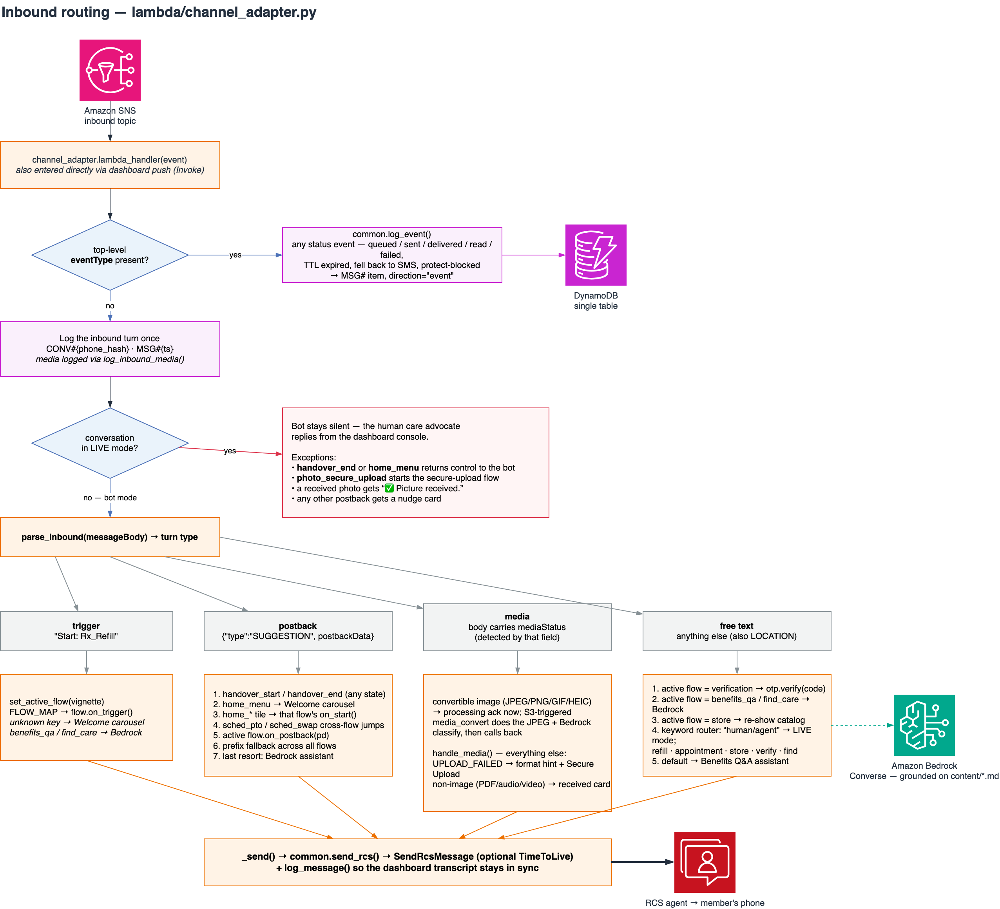

> **The diagram predates the typed-text screens.** It shows the LIVE-mode check
> straight after the inbound turn is logged. In the code, free text passes
> `_screen_freetext` first (emergency reply, service keywords, the opt-out check,
> escape words), so an emergency message or a typed `menu` is answered even while
> LIVE, and text a screen handles never reaches the LIVE gate or the free-text
> ladder. Every other kind of turn meets the opt-out check before the LIVE gate
> too. The LIVE
> exceptions list in the diagram also lacks its fifth entry (a native-action chip
> is answered with silence), and the keyword router in the free-text box matches
> whole words. The bullets below are current.

Reading it top to bottom:

- **Status events short-circuit.** Anything with a top-level `eventType` is
  logged as a transcript item with `direction="event"` and nothing else happens.
  That's what powers the per-recipient sent/failed/delivered/read counts on the
  Recipients tab. The check is on the *presence* of `eventType`, not a list of
  names, because the RCS status set is larger than the ones the counters use —
  the full `EventType` enum for RCS is `RCS_QUEUED`, `RCS_SENT`,
  `RCS_DELIVERED`, `RCS_READ`, `RCS_FAILED`, `RCS_TTL_EXPIRED`,
  `RCS_PROTECT_BLOCKED` and `RCS_FALLEN_BACK_TO_SMS` (plus `RCS_ALL`, which is a
  subscription shorthand and never arrives as an event) — and an unrecognized
  name must not fall through and be mistaken for an inbound member message.
  `common.log_event` prints a plain-English line for the types it knows and a
  "look this one up" line for the ones it doesn't, so a new event type is visible
  in CloudWatch rather than silent.

  TTL expiry is the single `RCS_TTL_EXPIRED`: it means no delivery confirmation
  arrived, and it counts as a failure on the Recipients tab. Opt-outs surface
  through the opt-out list rather than as an event here (what the adapter
  records when a member texts `STOP` is a separate transcript marker, covered in
  §2.1). The one-liner that re-derives the enum is in a comment above
  `common._EVENT_EXPLANATIONS`.
- **A fallback gets its own column, and is counted twice on purpose.**
  `RCS_FALLEN_BACK_TO_SMS` increments *Fell back to SMS*, while the sibling
  `RCS_FAILED` / `RCS_TTL_EXPIRED` event for the same message still increments
  *Failed*. The two are not correlated away: the RCS leg genuinely failed and the
  member was genuinely reached, and reading the columns together as "RCS didn't
  land, SMS covered it" is the honest summary. Deduplicating would mean matching
  `messageId` across rows to hide a number a production operator wants to watch.
- **Every inbound turn is logged exactly once**, before any routing decision, so
  the dashboard transcript is faithful even when a flow later errors.
- **Typed text is screened before anything can swallow it.** For free text,
  `_screen_freetext` runs ahead of the LIVE gate, every sticky flow, the keyword
  router and the AI, in this order:
  1. **Emergency language** — a short, reviewed list of whole-word patterns
     (chest pain, can't breathe, overdose, self-harm phrases, a threat to hurt
     someone, "I think I'm dying", "I can't go on", a bare `911` or `988`, …)
     gets one fixed reply: call 911, or call or text 988, with a Call Member
     Services chip and Main Menu. It applies in every mode, including LIVE, where
     the reply is labeled "Automatic safety reply" in the transcript and the
     CloudWatch line says the thread is live. The numbers are US numbers in one
     constant block in `channel_adapter.py`; a deployment outside the US must
     change them. This is a safety net for common phrasings, **not a triage or
     classification system**: it matches words, reads no context or negation, and
     misses whatever nobody listed. The one exception to "every mode" is a member
     on the opt-out list (step 3): the reply would be refused, so it is skipped,
     with a log line that says an emergency went unanswered.
  2. **Service keywords** — a message the service has already answered: one
     that begins with the keyword in its `messageKeyword` (a keyword registered
     on the agent, such as `UNSTOP`), or the built-in `STOP` and `HELP`, which
     arrive with no `messageKeyword` and are recognized by their text. The
     adapter sends nothing and records a marker (§2.1).
  3. **The opt-out list** — a sender the service has opted out gets no reply at
     all, because every send to them would be refused: no flow, no keyword
     router, no model call by the adapter, only an `OPTED_OUT_SKIPPED` transcript
     marker (§2.1). Typed text meets this check here, after the keyword check, so
     that `UNSTOP` is still recognized; every other turn (a button tap, a shared
     location, media, a `Start:` message) meets it right after it is logged, ahead
     of the LIVE gate. A photo's reply is skipped the same way, but its
     conversion and classification still run in `media_convert` (§2.1).
  4. **Global escape words** — exactly `menu`, `main menu`, `home` or `start
     over` clears the active flow, leaves LIVE mode and sends the welcome;
     exactly `human`, `agent`, `representative` or a short phrase such as "talk
     to a person" hands over (ignored while LIVE, when a human already has the
     thread). Matches are exact, never substrings, so "I'm at home" is not an
     escape.
- **LIVE mode gates the bot.** Once a conversation is handed to a human, the bot
  stops replying — apart from the screened typed text above, with five
  deliberate exceptions, all of them there so a member is never left tapping a
  dead button:
  - `handover_end` **or** `home_menu` returns control to the assistant.
    `home_menu` is included because it's on nearly every card, so it's the
    escape hatch a stuck member actually reaches for (e.g. a demo left in LIVE
    mode with nobody staffing the dashboard).
  - `photo_secure_upload` starts the secure-upload flow, because tapping it is
    an explicit member action rather than the bot interrupting.
  - Successfully-received inbound media gets a one-line “✅ Picture received.”
    acknowledgement — the full confirmation card is suppressed.
  - **A native-action chip** (dial, map, calendar, webview — the
    `ACTION_ONLY_POSTBACKS` list below) is answered with silence: the handset
    already ran the action, and a nudge would tell someone who just placed a call
    that the button "isn't active".
  - **Any other postback** gets a short nudge card pointing at the one button
    guaranteed to work, rather than being silently dropped.
- **`parse_inbound` classifies the turn** into trigger, postback, media, shared
  location, or free text. Inbound media arrives as a JSON
  envelope inside `messageBody`; this sample detects it by its `mediaStatus`
  field. A shared location carries `"type":"LOCATION"`, and it routes to
  `handle_location` (§4.6) rather than being handed to the AI as raw JSON.
- **Postbacks resolve in priority order** (handover → main menu → home tile →
  cross-flow jump → active flow → prefix fallback across all flows → AI). The
  prefix fallback is what makes a chip tapped after the flow's TTL expired still
  work: `rx_*` finds the pharmacy flow even with no active flow record.
  **A tap on a native-action chip never reaches the AI.** Chips that show a map,
  add a calendar event, open a webview or dial run on the handset, and the phone
  still reports the tap to the topic. The chips the flows write are listed in
  `ACTION_ONLY_POSTBACKS` (`lambda/channel_adapter.py`) and dropped at the AI
  step, so Get Directions and Add to Calendar do not trigger an unrelated
  assistant reply; a flow that is active can still acknowledge its own chip.
  `scripts/check-rcs-registry.py` fails if a flow adds an action chip that is not
  listed.

  **The chips the AI builds follow one rule instead**, because a model cannot be
  held to a list. `common.build_suggestions` ignores whatever `postback` the model
  supplied for a `dial`, `open_url`, `calendar`, `view_location` or
  `share_location` chip and sets the id from `common.AI_ACTION_POSTBACKS`
  (`ai_dial`, `ai_open_url`, `ai_calendar`, `ai_view_location`,
  `ai_share_location`). The adapter is silent for exactly those ids, plus `call`
  and `find_care_location`, which earlier prompts told the model to use and which
  cards already in a member's thread may still carry. A `reply` chip keeps the id
  the model gave it, cannot claim a reserved one, and still reaches the assistant
  when tapped. Without the rule, a tap on the model's Call Member Services chip
  got "Connecting you to Member Services now" for a call the member had already
  placed, and ids the model improvised (`call_911`, `directions_main_clinic`) each
  cost a model call. An id improvised on a card sent before the rule is on no
  list, so a tap on one of those still goes to the assistant. The registry check
  builds every suggestion kind with a hostile id and fails if an action chip
  comes out unreserved, if the adapter stops recognizing the family (or starts
  recognizing a pattern instead of the fixed set), or if the prompt shows the
  model an action chip with a `postback`. (The routing diagram's last step,
  "Bedrock assistant", applies to every other unclaimed tap.)
- **Free text has its own ladder**: after the screens above, the deep-link
  keyword and generic greetings reset to the welcome (below), an active
  verification flow treats the text as a code, the AI use case examples pass it
  to Bedrock, and otherwise a small keyword router catches "human/agent",
  "refill", "appointment", "store", "verify", "find" before falling through to
  the Benefits Q&A assistant. The router matches whole words (with the
  inflections a member would type: "refills", "ordering", "doctors"), so "order"
  does not fire inside "disorder" nor "person" inside "personal".
- **Every send goes through `common.send_rcs`**, the one place the Lambdas call
  `SendRcsMessage`. Flow replies reach it through the adapter's `_send()`, which
  strips this project's internal keys — `_ttl` into `TimeToLive`,
  `_fallback_body` into `FallbackConfiguration`, `_redact_log` into what is
  persisted — logs the outbound message, and sleeps 1s between messages in a
  multi-message reply so they arrive in order. AI replies (`send_ai_response`)
  and operator replies (`handle_push`) call `common.send_rcs` directly and log
  the turn themselves, so they carry no TTL, fallback body, or redaction.

### 2.1 Keywords, and where a keyword is answered

The first branch in `handle_freetext` is a keyword check that opens the welcome
message. Two kinds of input reach it:

- **The configured deep-link keyword** (`deepLinkKeyword` in `content/brand.md`,
  default `Get started`) always resets to the welcome, even mid-flow. Somebody
  who scans the QR code is deliberately saying "start here", so abandoning an
  in-progress flow is the intent rather than a side effect.
- **Generic greetings** (`hi`, `hello`, `start`, `demo`, …) only reset
  when no flow is active. Otherwise typing "hi" at the AI assistant would
  silently throw away the conversation. Matching is done on a normalized form —
  lowercased, punctuation and emoji stripped, whitespace collapsed — so
  `Get started`, `get started!` and `  GET  STARTED ` all hit.

The keyword lives in application code rather than in the service, and that's
the point worth drawing out in a technical dive. AWS End User Messaging has a
first-class keyword feature (`put-keyword` / `describe-keywords` /
`delete-keyword`) that pairs a keyword with a canned response and an
opt-in/opt-out/help action. When a message begins with a registered keyword,
**the service answers on the agent's behalf**, so that reply can only be a fixed
message string — no rich cards, no suggested replies, no flow state written to
DynamoDB, no branch on who sent it. Observed with a registered keyword on a
testing agent: the service sends the configured response and also publishes the
inbound message to the two-way topic, with `messageKeyword` set. The message
therefore *does* reach this Lambda, and the adapter treats a message that begins
with its `messageKeyword` as already answered (below). That is why the demo does
not register its deep-link keyword with the service: the member would get the
fixed string and never see the welcome message.

Handling the keyword here instead costs nothing but code, and buys the entire
vocabulary back: the reply is the three-card welcome message (see §4.1),
personalized with the recipient's name from the Recipients tab and recorded as
the active flow.

**`STOP`, `HELP` and `UNSTOP` are the opposite case: the bot's code stays out of
the reply on purpose, and the deploy registers the text instead.** Everything
below was observed on a real Android handset against a **testing** agent.
Nothing here has been checked against a country-launched agent.

- **The service owns the reply, and the deploy registers its text.** A new agent
  has AWS's default `STOP` (action `OPT_OUT`) and `HELP` (`AUTOMATIC_RESPONSE`)
  keywords, and self-managed opt-outs are off by default, so End User Messaging
  sends those replies even if this Lambda is throttled or broken, which is what
  regulators care about. Left alone, the replies are the service's default text:
  typing `Help` got "Default Help Message", and typing `stop` got "Default Stop
  Message" and added the number to the account's Default opt-out list within the
  same second. There is no `UNSTOP` or `START` keyword until one is registered.
  So `cdk deploy` registers them: the EUM wiring custom resource
  (`lambda/custom_resources/eum_wiring.py`) writes a `HELP` reply, a `STOP`
  reply and an `UNSTOP` keyword with the `OPT_IN` action, with text built from
  `content/brand.md`, right after it enables two-way messaging. It writes `HELP`
  or `STOP` only while the keyword is empty, still the service default, or still
  the text the previous deploy wrote, so a reply you set by hand stays, and it
  adds `UNSTOP` only when none exists (or refreshes the text it wrote itself).
  It never fails the deploy: the result is the `KeywordsStatus` stack output
  (`ok`, or `error` with the AWS error code), and `-c registerKeywords=false`
  skips the step (`skipped`). On a testing agent the deploy reported
  `ok (HELP: registered, STOP: registered, UNSTOP: created)`, and a handset then
  received the registered `HELP`, `STOP` and `UNSTOP` replies from the service.
  The bot's code still sends nothing for these words (next bullets). The exact
  rules and the `put-keyword` commands for doing it by hand are in `AGENTS.md`
  ("Register the keyword replies"), and what `cdk destroy` leaves behind is in
  `SETUP.md` ("Teardown").
- **Check that the message text begins with `messageKeyword`.** The built-in
  `STOP` and `HELP` events reached the topic with **no** `messageKeyword` field
  (the fields seen were `agentIsoCountryCode`, `destinationNumber`,
  `inboundMessageId`, `messageBody`, `originationNumber` and `rcsBusinessId`). A
  keyword *you* register with `put-keyword` (observed with `UNSTOP`) arrives
  **with** `messageKeyword`. The adapter checks the text against it (next
  bullet).
- **This Lambda stays silent, and checks the text.** `process_inbound` passes the
  payload's `messageKeyword` to `parse_inbound`, and `_screen_freetext` believes
  it only when the message text begins with that keyword
  (`_keyword_matches_text`). A marker the text does not begin with is logged as
  `IGNORED messageKeyword …` and the message is routed as ordinary text, so a
  member who has just opted back in is not silenced. A message that does begin
  with its keyword is treated as already answered by the service, which covers
  every keyword an operator adds on the Settings tab: a custom keyword is
  answered once, by the service, and not a second time by the bot. (AWS documents
  that keywords match the *beginning* of the message body, so a longer message
  that starts with a registered keyword can carry `messageKeyword` too; it gets
  the same silence.) With no usable `messageKeyword`, a message that is exactly
  `STOP`, `UNSUBSCRIBE`, `HELP` or `UNSTOP` is handled the same way. That text
  rule is what recognizes the built-in `STOP` and `HELP`. `cancel`, `end`,
  `quit`, `remove` and `start` count only when the service reports them, because
  members type them as ordinary words inside the flows, and `start` is also a
  welcome greeting. The keyword's name only chooses the transcript marker: the
  opt-out words AWS documents (`STOP`, `UNSUBSCRIBE`, `CANCEL`, `END`, `QUIT`,
  `OPTOUT`, `REMOVE`, `ARRET`, `TD`) write `KEYWORD_STOP`, `HELP` writes
  `KEYWORD_HELP`, `UNSTOP` and `START` write `KEYWORD_START`, and anything else
  writes `KEYWORD_CUSTOM` (via `common.log_indicator`; the member's own text is
  already logged as the inbound turn). A `SERVICE KEYWORD …` line goes to
  CloudWatch. A hit sends nothing and makes no Bedrock call, so this stack can
  never confirm an unsubscribe it did not perform. A `STOP` marker also makes the
  bot treat that member as opted out for the next 30 seconds, and a `START`
  marker makes it ask the service again (next bullet).
- **The service enforces the opt-out, so the bot asks the service's list before
  it answers.** After `stop`, every send to that number (the
  three welcome cards and an AI reply) was refused with `ConflictException` reason
  `DESTINATION_PHONE_NUMBER_OPTED_OUT`, and nothing reached the phone. A bot that
  does not notice still makes a model call, and writes outbound transcript rows
  next to `SEND_FAILED` events, for every message such a member sends. So
  `process_inbound` calls `DescribeOptedOutNumbers` on the `Default` list (the
  RCS agent's list) for the sender before anything else can reply. An opted-out
  sender gets no flow, no keyword router, no model call from the adapter and no
  send: the inbound message is still logged first, an `OPTED OUT: skipping the
  reply …` line goes to CloudWatch, and an `OPTED_OUT_SKIPPED` marker goes into
  the transcript. The callback that sends a converted photo's confirmation card
  makes the same check. Operator sends from the dashboard are unchanged.
  - **A photo is the exception to "no model call".** `media_convert` starts from
    the S3 event for the uploaded file, not from the adapter, and it has no
    opt-out check. So a photo from an opted-out member is still converted for the
    dashboard and classified: one description call, plus up to two orientation
    checks when the file carries no EXIF orientation or orientation 1, so up to three vision
    calls. Only the confirmation card is skipped. The adapter cannot prevent
    those calls. Gating them would mean giving `media_convert` the same lookup
    and `sms-voice:DescribeOptedOutNumbers` on its role, which this sample does
    not do. Every other kind of message the member texts costs no model call.
  - **The service's list stays the source of truth.** The stack stores no opt-out
    flag. A flag would drift: an admin's `delete-opted-out-number`, or an
    `OPT_IN` keyword the member texts, clears the service's entry, and a stored
    flag would go on silencing a member who had re-subscribed. What the adapter
    keeps is each answer for 30 seconds (`OPT_OUT_CACHE_TTL_SECONDS`) in a small,
    bounded per-container dict, so a burst of messages costs one call (most
    control-plane calls are limited to about one request per second per account
    and Region). Texting `STOP` marks the member opted out in that dict at once,
    since the service updates its list in the same second; `UNSTOP` drops the
    entry so the next message asks again; otherwise a re-subscribed member is
    answered again within 30 seconds. If the RCS agent uses an opt-out list other
    than `Default`, change `OPT_OUT_LIST_NAME` in `lambda/channel_adapter.py`, the
    list name in `dashboard_handler.opted_out_numbers` and the stack's grant to
    match, or the check never finds anyone.
  - **It fails open.** A throttled, denied or timed-out lookup counts as "not
    opted out", so a failed lookup can never silence a member; the worst
    case is the behavior this stack had before the check. The failure is logged
    once per error class per container. The lookup uses a client with short
    timeouts and one retry, and needs `sms-voice:DescribeOptedOutNumbers` on the
    channel adapter's role; without it every lookup is denied and the bot behaves
    as it did before the check.
  - **Emergency wording asks afresh.** The one message that must arrive does not
    trust a cached answer, so a stale "opted out" cannot swallow it. A member who
    really is opted out cannot be answered from this number, which the log says
    in a line of its own because a person may want to reach them another way.
  - **This is not a suppression list.** It reads the service's list and keeps no
    list of its own. AWS's RCS best-practices page says: "AWS End User Messaging
    provides opt-out list management for SMS and MMS. For RCS, coordinate your
    opt-out handling with both the AWS End User Messaging opt-out lists and your
    own application-level records." A production sender should keep its own
    suppression record, check it before every send in `common.send_rcs`, and
    honor it across channels. The Recipients tab reads the same list and flags the
    number.
- **Recovering by text needs an `OPT_IN` keyword.** With only `HELP` and `STOP`
  on the agent, `UNSTOP` and `START` typed after `stop` did nothing: the service
  sent no reply and the opt-out entry stayed. After
  `UNSTOP` was registered with action `OPT_IN`, the member texted `Unstop`, the
  service replied with the keyword's message, removed the number from the list
  (one entry to none) and published the event with `messageKeyword` `UNSTOP`.
  `START` was not tested as a keyword. The deploy registers `UNSTOP` unless it
  was run with `-c registerKeywords=false`. Without an `OPT_IN` keyword only an
  admin can clear the entry, with `aws pinpoint-sms-voice-v2
  delete-opted-out-number --opt-out-list-name Default --opted-out-number
  <E.164>`.
- **Not observed.** The behavior of a country-launched agent; whether an `OPT_IN`
  keyword other than `UNSTOP` (for example `START`) behaves the same; and the set
  of default keyword names beyond `STOP` and `HELP`. The payload names the
  keyword that matched, not its configured action, so the adapter keys on names.

### 2.2 Starting from the phone: inbound deep links

Normally the operator sends first from the dashboard. An RCS agent can also be
opened from the member's side via an **inbound deep link** — a GSMA-standard
`sms:` URI that opens the messaging app with a message to the agent
pre-populated. Pair it with the keyword branch above and scanning a QR code
lands the member straight on the welcome message.

Two things to know about it:

- **You generate it in the console.** Generate it under your RCS agent →
  **Testing** → **Inbound deep link** (see
  [Getting started with RCS](https://docs.aws.amazon.com/sms-voice/latest/userguide/rcs-getting-started.html),
  Step 4), then paste it into the Recipients tab,
  which renders the QR code, shows the pre-populated body, and warns if that
  body doesn't match `deepLinkKeyword` (with a one-click fix). The pasted link is
  held in `localStorage` only.
- **It is not an onboarding mechanism for a testing agent.** A testing agent
  gives full API access but restricts *delivery* to registered test devices, so
  the QR code does nothing for a handset that hasn't accepted the tester
  invitation. Scan-to-start marketing demos that work for any passer-by are
  running a launched agent, usually behind an SMS short code.

---

## 3. Rich media — two ingress paths

The two rich-media use case examples are a deliberate pair, not redundancy. They exist
to show the trade-off side by side.

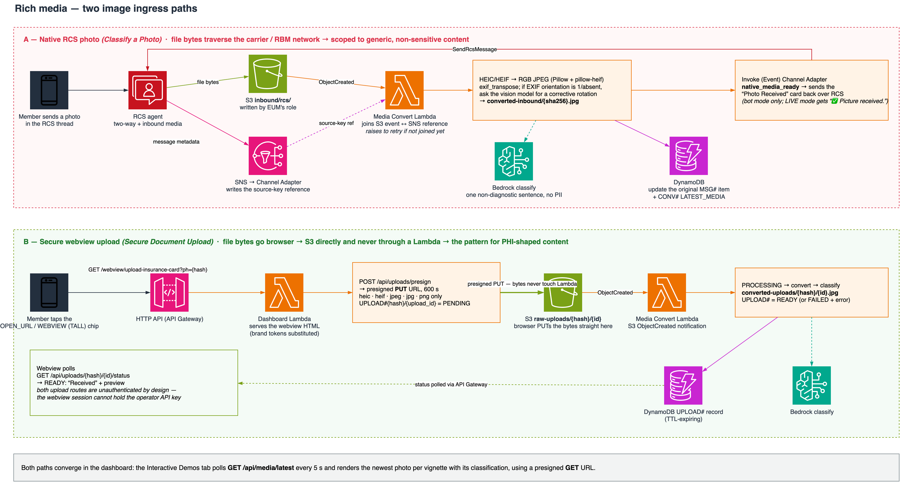

**A — native RCS photo** (`Classify a Photo`, `lambda/flows/photo_submission.py`).
The member just sends a picture in the thread. End User Messaging writes the
file into `inbound/rcs/` using its own role, and separately publishes the
message to SNS. Media Convert has to *join* those two events — the S3
notification can arrive before the SNS message that identifies which
conversation the object belongs to, so it raises when the reference isn't
available yet and lets S3/Lambda retry rather than silently dropping the photo.
Because the bytes traverse the public carrier/RBM network, this use case example is
deliberately scoped to a **generic, non-sensitive** example — it asks for "any
photo" and describes what's in it, not a prescription-label photo, because a
prescription label routinely carries PII/PHI, which is what path B is for.

**B — secure webview upload** (`Secure Document Upload`, `lambda/flows/insurance_upload.py`).
The member taps an `OPEN_URL` suggestion with `Application: WEBVIEW` and
`WebviewViewMode: TALL`. The webview asks for a presigned `PUT` (600s, restricted
to `heic`/`heif`/`jpeg`/`jpg`/`png`) and the browser uploads directly to S3. The
file bytes never touch a Lambda or any other API surface. This is the transport
to choose for sensitive content, but it is one control, not a complete PHI
design (see SECURITY.md).

Both paths land in the same converter, which:

- normalizes HEIC/HEIF to RGB JPEG with Pillow + pillow-heif. The native path
  converts `image/heic` and `image/heif`
  (`common.CONVERTIBLE_IMAGE_MIME_TYPES`) in addition to the JPEG, GIF and PNG
  images AWS lists for inbound media, and the webview upload accepts them, so a
  HEIC file that arrives is converted rather than assumed unsupported,
- applies `ImageOps.exif_transpose` so orientation is baked into the pixels,
- for JPEG, PNG and GIF images whose EXIF orientation is `1` or absent (the
  observed iOS in-app browser case), asks the vision model whether the image is
  upside down, and turns it 180 degrees only when a second look at the turned
  copy agrees. Quarter turns are never applied, anything uncertain leaves the
  image alone, and HEIF is excluded because its rotation is already applied when
  it is decoded,
- classifies the image with a prompt that explicitly forbids transcribing names,
  numbers, IDs, or medical details — one general sentence only. Bedrock receives
  a downscaled JPEG copy (1568 px on the long edge, quality 80), never the stored
  image. When no description comes back, the stored classification stays empty:
  the RCS confirmation card and the upload webview leave their "What we see" line
  out, and the Demo tab labels the gap "(classification unavailable)".

Path A then calls the channel adapter back so the confirmation card is built and
logged by the same code that builds every other outbound message. That callback
checks the opt-out list first (§2.1), but conversion and classification have
already run by then, so for a member who has opted out only the card is skipped.
Path B just flips its `UPLOAD#` record to `READY`; the webview is polling for
that.

**The same choice exists on the way out.** Ingress is where it usually gets
noticed, but a document you *send* faces it too: a `FileMessage` is fetched from
your bucket by End User Messaging, rehosted and carried over the carrier network,
while a `WEBVIEW` suggestion pointing at a presigned GET keeps the bytes on
HTTPS between S3 and the member's browser. The pharmacy flow sends one document
each way in a single exchange for exactly that contrast — see *Rx Documents* in
§4.2, and note that neither the bucket policy for the EUM service principal
(`media/*` and the inbound prefixes) nor the channel adapter's role covers
`secure-docs/`. A file message naming that object was refused when tried on a
test deployment (see *Three details* under §4.2).

> This demo is **not** HIPAA-compliant. See the notices in the
> [README](../README.md) before adapting either path for real PHI.

---

## 4. Use case example flows

Twenty use case examples — thirteen member-facing and seven internal — all
triggerable from the dashboard and all drivable from the phone. The dashboard's
Interactive Demos tab shows them as one flat list; three of the internal
entries are operator tooling that lives in the Settings tab instead of the list:
the Camera & Mic Probe diagnostic and the two IVS webview experiments (§4.15),
under a **Diagnostics & experiments** section. The four remaining internal
entries are staff self-service (clock in/out, schedule, PTO, shift swap). The
flow modules live in [`lambda/flows/`](../lambda/flows/) and are registered in
`FLOW_MAP`; `benefits_qa` and `find_care` have no module because they're handled
by the Bedrock assistant.

Each flow module exposes the same three entry points — `on_start` (member
arrived via the welcome, a greeting, or the deep link), `on_trigger` (operator
sent it from the dashboard), and `on_postback` (member tapped a chip) — which is
why any use case example can be entered from either direction.

### 4.1 Welcome — the educational front door

The first message a newly verified tester sees is not a menu of every use case example;
it is a short lesson about the channel itself. `flows/welcome.py` sends **three
standalone `RichCard` messages**, delivered ~1s apart by `_send`:

1. **What this is** — that the thread is an AWS End User Messaging RCS demo, and
   what RCS adds over SMS (branded cards, images, chips, native actions).
2. **Verified brand, opt-in/opt-out** — how registration gives the agent the
   verified identity shown in the thread header, and that the member controls
   whether they are in the conversation: texting `STOP` opts out, and End User
   Messaging itself answers `STOP` and `HELP`, with the replies registered for
   them (the deploy writes those from `content/brand.md` unless you skip it,
   §2.1).
3. **SMS fallback** — what per-message fallback does, worded from
   `common.sms_fallback_active()` so it states truthfully whether *this*
   deployment has it enabled, followed by a compact row of message-level `Reply`
   chips (`home_*` postbacks) for self-navigation.

Standalone cards are a deliberate choice over a carousel. On the iOS and Android
handsets tried, the cards of a multi-card carousel arrived in a different order
and could split across messages, while standalone cards sent about 1 s apart by
`_send` rendered consistently on both. **Only the Wellness Store, where a
swipeable product catalog is the actual lesson, still uses a carousel**
(§4.5). Everything else, including this welcome, is standalone cards.

The old "twelve-tile menu carousel" is gone: pushing a specific use case example to a
device during a demo is the dashboard's job (the audience usually watches the
web app and the handset side by side), and the welcome's compact chip row plus
each leaf flow's `Main Menu` chip keep the phone able to self-navigate without a
wall of cards.

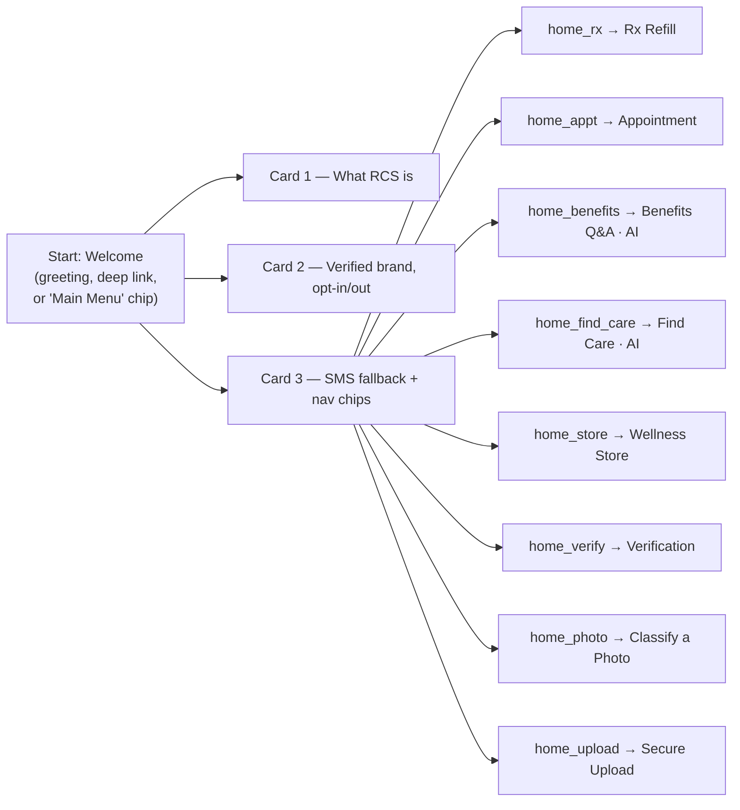

Every leaf flow offers a `Main Menu` chip back to this welcome, so the demo
never dead-ends.

### 4.2 Pharmacy Rx refill

The suggestion-type showcase: `Reply`, `DialPhone`, `OpenUrl` (webview),
`ShowLocation` and `CreateCalendarEvent` across the flow's two cards — the
refill reminder carries `Reply` + `DialPhone`, and the confirmation carries
`OpenUrl` + `ShowLocation` + `CreateCalendarEvent`. They're split because a
card takes at most **4** card-level suggestions, and because the calendar and
directions actions only make sense once the refill is actually confirmed.

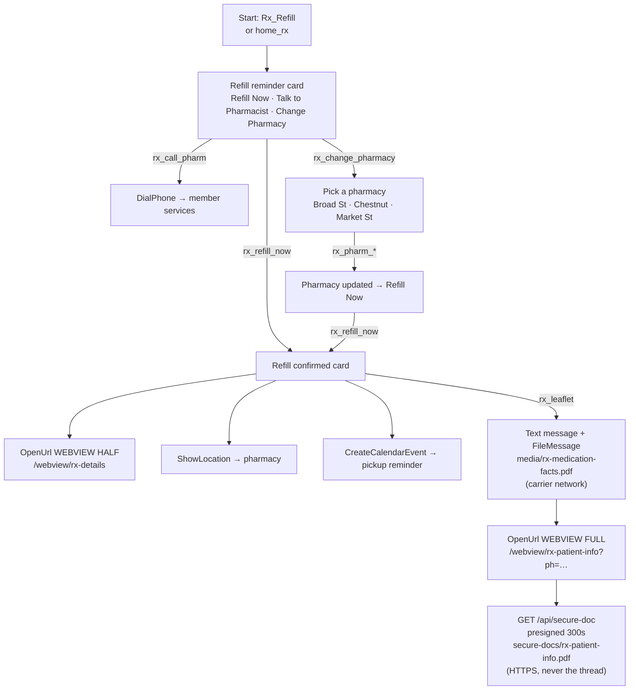

`DialPhone` uses the contact number from `content/brand.md`, so re-theming the
demo re-points the call.

**Rx Documents — two documents, two transports.** This is the flow's other
lesson, and the reason `rx_leaflet` sends what it sends. Tapping **Rx Documents**
returns *two* messages: a text message explaining the split, then a `FileMessage`
pointing at `media/rx-medication-facts.pdf`. Two messages because `Content` is a
tagged union — a file message cannot also carry a caption, a title or a
description, so any wording has to be its own message.

`FileUrl` is an `s3://` URI; End User Messaging downloads the object, rehosts it
and presigns it for the aggregator. That keeps your bucket private, and it is
also the compliance boundary: **the bytes leave your account and cross the
RCS/carrier network, with Google RCS for Business in the delivery chain.** So the
document on that path is *Magic Medicine Facts* — a generic fact sheet, byte-identical
for every member, with no name, address, prescriber or directions in it.
`ThumbnailUrl` is optional and only changes what the member sees before opening it.

The member's own prescription record never goes near that path. The file
message's message-level suggestions include an `OpenUrl` `WEBVIEW` chip
(`WebviewViewMode: FULL`) to `/webview/rx-patient-info?ph=<hash>`; that page calls
**`GET /api/secure-doc?ph=…&doc=patient-info`**, which returns a 300-second
presigned GET for `secure-docs/rx-patient-info.pdf`, and the browser fetches the
bytes from S3 over HTTPS. Nothing about the member enters the message stream.

Three details make that structural rather than a matter of remembering:

1. **`secure-docs/` is deployed by its own `BucketDeployment`** (`SecureDocsDeploy`),
   so it is a distinct S3 key prefix rather than a folder under `media/`.
2. **Both grants that can authorize the service's read stop at the sendable
   prefixes.** The bucket policy grants the `sms-voice.amazonaws.com` service
   principal `s3:GetObject` on `media/*`, `inbound/*` and `converted-inbound/*`
   only — the three prefixes something actually hands to the service as a
   `FileUrl`. The channel adapter's role has `s3:GetObject` on `media/*`,
   `inbound/rcs/*` and `converted-inbound/*` and nothing else. On a test
   deployment a send needed the role's permission: the bucket's server access log
   shows the read behind each accepted media send under that role's session, not
   under the service principal, and with an explicit Deny on `s3:GetObject` (for
   the whole bucket) attached to the role, an image card and a PDF file message
   both failed with `ValidationException` (`RESOURCE_NOT_ACCESSIBLE`), and a PDF
   file message sent after the Deny was removed succeeded (the card was not
   re-sent). A `FileMessage` naming `secure-docs/rx-patient-info.pdf` and one
   naming a member photo under `converted-uploads/` were also sent, and both were
   refused with the same `ValidationException`; one naming
   `media/rx-medication-facts.pdf`, as a control, succeeded. Treat this as an
   observation from this sample's testing, not a guarantee: each send was made
   once, the sends were not repeated with a wider grant added, `raw-uploads/` was
   not tried, and this sample did not test whether the bucket policy's statement
   is used for a send. The bucket policy and the role grant are separate
   mechanisms: do not widen one assuming the other still holds the line. A third
   role could in principle do it, because the service reads with the calling
   role's permissions: the dashboard's role holds `sms-voice:SendRcsMessage` (the
   dashboard and the adapter share that grant) and `s3:GetObject` on
   `secure-docs/` and `converted-uploads/`, which it needs to presign the Rx
   record and the converted member uploads. `dashboard_handler`
   makes no send call, so nothing sends from it today, and removing the send
   actions from the dashboard's role would close the path.
3. **`secure-docs/` is deliberately *not* in `dashboard_handler._MEDIA_ALLOWED_PREFIXES`.**
   `GET /api/media?key=` presigns any key under an allowed prefix, so allow-listing
   it there would make the record presignable by anyone who guessed the key. The
   secure route instead takes a document *id* and maps it to a key server-side.

**What this does not claim.** `/api/secure-doc` is unauthenticated, like every
other webview-backed route — a member's in-app browser has no API key to send.
It is scoped to a `ph` conversation hash, and `common.hash_phone` is an unsalted
SHA-256 of the E.164 number, so someone who knows the number can compute the
hash; the "must belong to an existing conversation" check stops a scan, not a
targeted guess. Choosing the transport is one control. A system serving real PHI
still owes a member session on this route, per-member object keys, and an access
log of every fetch (the API access log records the route, not which member or
document). The demo makes the transport decision visible because that is
the part builders get wrong; see also [SECURITY.md](../SECURITY.md).

### 4.3 Appointment reminder / clinic-initiated reschedule

Two use case example ids (`appt_reminder`, `appt_reschedule`) share one module, because
they converge the moment a new slot is picked. They are **not** two entry points
into the same scenario:

- **`appt_reminder`** — the clinic confirms an upcoming visit. Confirm,
  reschedule or cancel are all acceptable answers.
- **`appt_reschedule`** — the clinic is *moving* the visit because the provider
  became unavailable. The member didn't ask for this and the original slot no
  longer exists, so the message opens straight into a required choice. It's the
  demo's second event-driven send (with `rx_refill`).

That difference is why `_reschedule_options()` takes `clinic_initiated`. The
slot chips are identical either way; only the opening line changes, and it has
to — as the first message in a conversation, "I can help you reschedule" tells
the member neither which appointment nor why, so the clinic-initiated branch
names the visit and gives the reason instead.

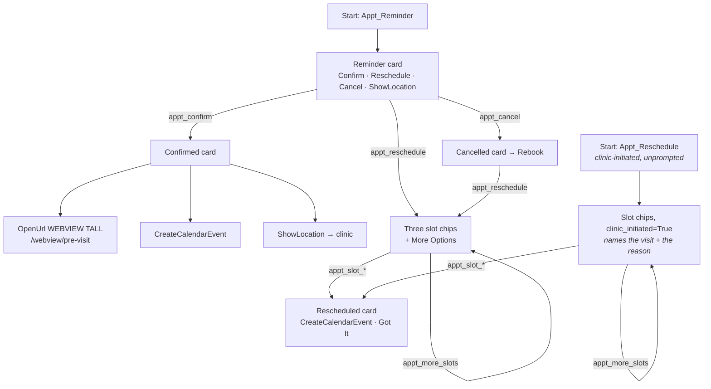

The pre-visit webview is `TALL` rather than `HALF` because it's a form, not a
detail pane — the two view modes are worth demonstrating side by side.

### 4.4 Verification code (`TimeToLive`)

The one use case example that exists specifically to show message expiry.

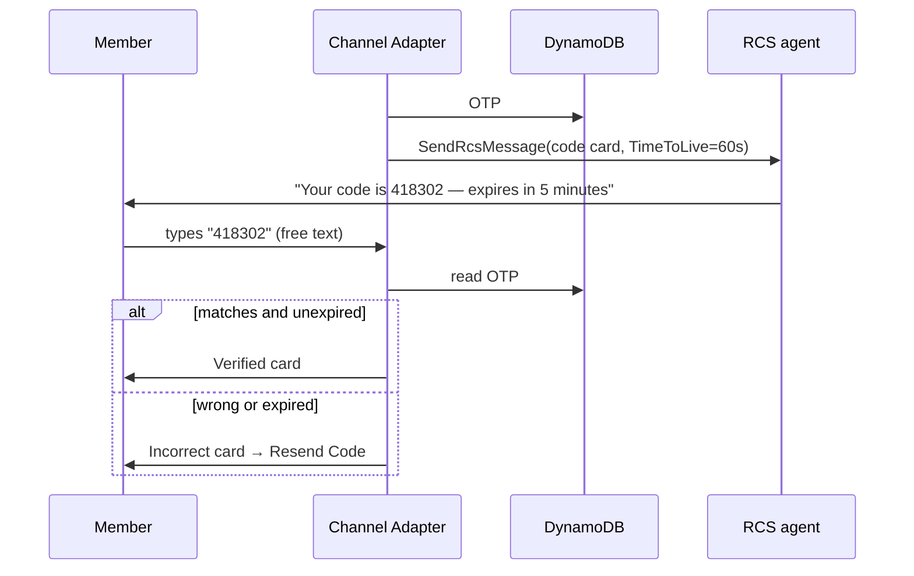

`TimeToLive` is set on the *outbound* message: if the carrier can't deliver the
code in time, the code is never shown rather than arriving already-dead. The
`Resend Code` chip issues a fresh code and a fresh TTL.

**Two different windows, deliberately.** `flows/otp.py` keeps
`CODE_TTL_SECONDS = 300` (how long the code is accepted) separate from
`DELIVERY_TTL_SECONDS = 60` (how long RCS gets to deliver it). Collapsing them
into one number looks tidier and is wrong: TTL expiry is what triggers the SMS
fallback, so a delivery window equal to the validity window would send the
fallback at the instant the code stopped working. Giving RCS one minute leaves
four for the member to act on whatever arrives. The short window is also what
makes `RCS_TTL_EXPIRED` observable in a demo — you can watch the event fire
inside a minute instead of waiting out a realistic window.

**And only this use case example sets one.** `_ttl` is deliberately per-message rather
than a stack-wide default, so nineteen of the twenty use case examples send with no
`TimeToLive` at all. A global default would be a more convenient test harness —
any use case example could then be used to force an expiry — but it would misrepresent
the API. `TimeToLive` is a deliberate per-message choice about whether a late
delivery is worse than no delivery, and that is true of a one-time code and false
of an appointment reminder or a catalog carousel, which are all better late than
never. Keeping it on the one use case example that teaches expiry is the honest default;
a reader who wants it everywhere can see exactly where to add it.

### 4.5 Wellness store (conversational cart)

State that survives across turns, stored in DynamoDB rather than in the message.

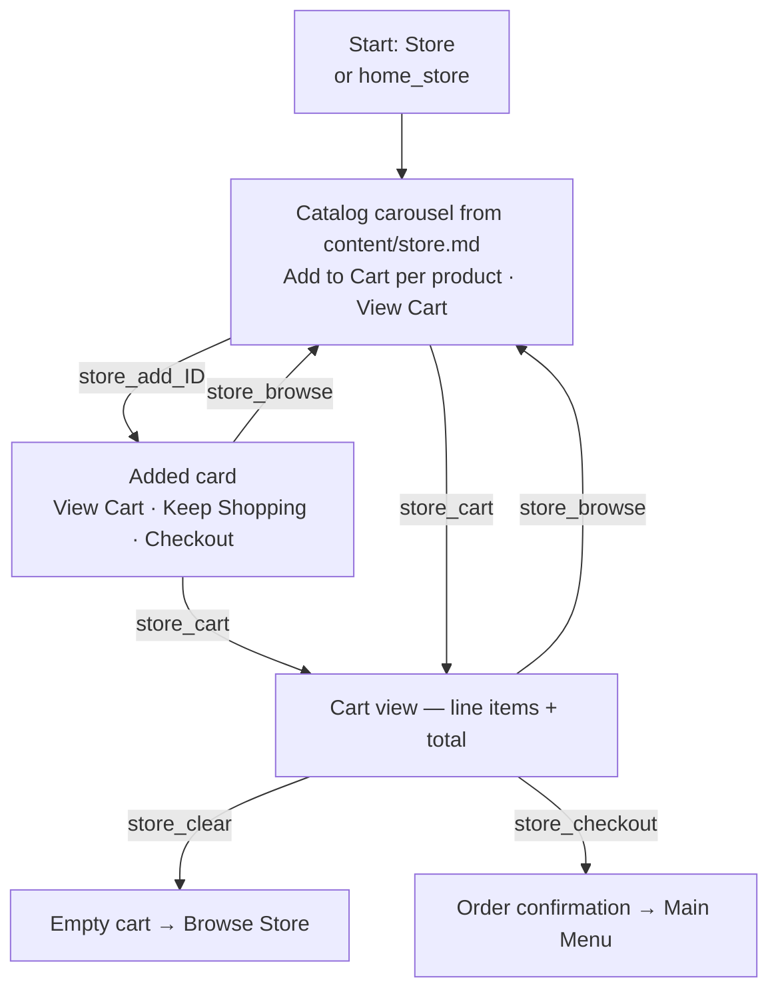

An empty cart renders a different card than a populated one, and free text while
the store flow is active re-shows the catalog instead of falling through to the
AI assistant.

### 4.6 Benefits Q&A and Find Care (AI)

The two `AI_DRIVEN_VIGNETTES`. No flow module — the adapter calls Bedrock
Converse with the relevant `content/*.md` as grounding and asks for a JSON
contract so the model's answer can be rendered as RCS rather than as a wall of
text.

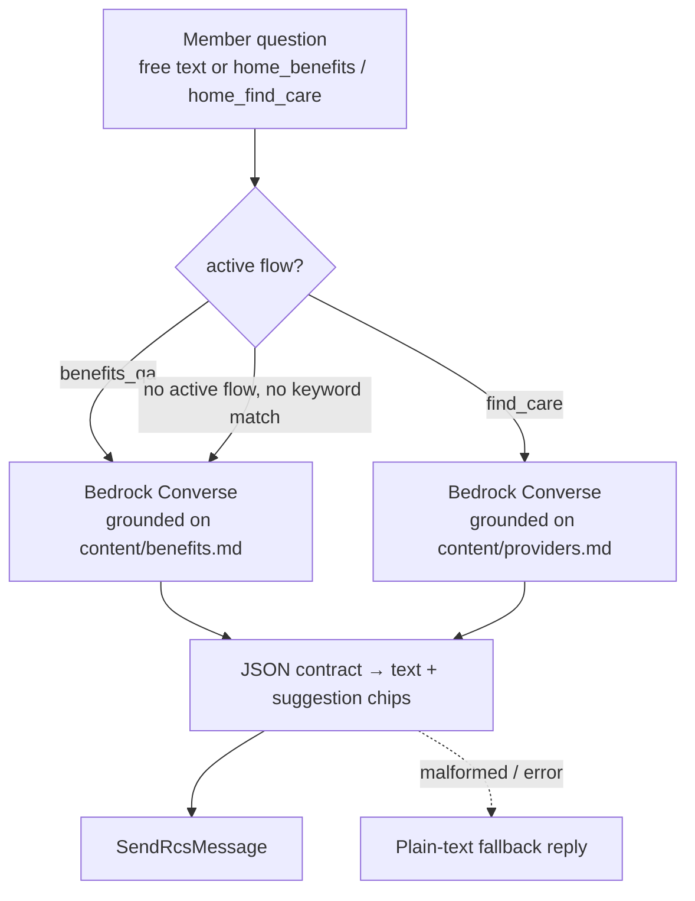

Because unmatched free text defaults to the Benefits assistant, the demo always
has something sensible to say — there is no "I didn't understand that" state.

**Find Care also demonstrates `RequestLocation`.** Rule 7 of the find-care
system prompt tells the model to offer a single `share_location` suggestion
whenever it does not yet know where the member is. Tapping it opens the native
map picker, and the handset replies with a `messageBody` of
`{"type":"LOCATION","latitude":…,"longitude":…}` — which `parse_inbound`
classifies as `location` and `handle_location` feeds back into the same
Bedrock conversation as a normal turn. The chip's own id is the reserved
`ai_share_location` (§2). AWS documents the coordinates as arriving "in a
separate inbound location event"; the adapter acts on the `LOCATION` message as
the turn that matters and ignores a `SUGGESTION` postback carrying that id. Three
things are worth knowing:

- The reply is **coordinates only** — no street address, no place name. Any
  human-readable location is your own reverse geocode.
- The member may simply never tap it, so the prompt keeps asking for a city in
  words as well. A `RequestLocation` chip is a request, not an API call.
- Coordinates are precise enough to identify a home, and the transcript is
  readable from the dashboard, so both the stored transcript and the AI turn get
  the pair rounded to three decimal places (~100 m).

### 4.7 Live-agent handover

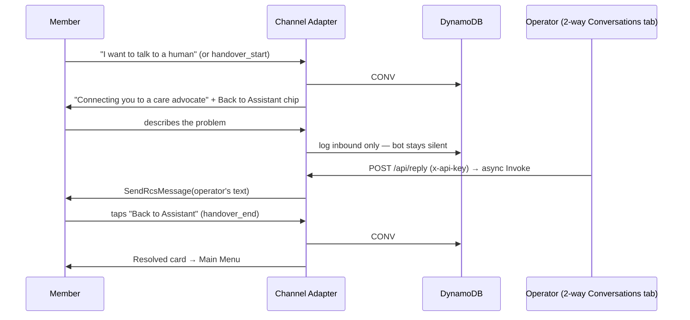

The operator never calls `SendRcsMessage` directly — the dashboard invokes the
channel adapter, so human replies are constructed and logged by exactly the same
code as bot replies and appear in the same transcript.

Two typed inputs still get a bot answer while the thread is LIVE, both screened
ahead of the LIVE gate (§2): `menu` (and `main menu`, `home`, `start over`)
returns the member to the assistant and sends the welcome, and emergency wording
gets the fixed 911/988 reply. That reply is logged as an outbound turn labeled
"Automatic safety reply", so the operator can tell it from a colleague's message,
and the thread stays LIVE.

### 4.8 Internal staff: clock in / out

Same channel, workforce use case, grounded on `content/workplace.md`.

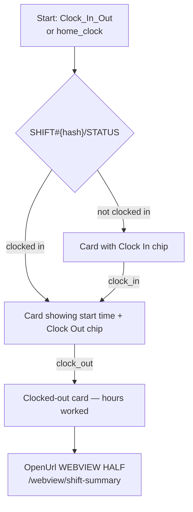

### 4.9 Internal staff: my schedule

The hub for the other two internal flows — it demonstrates cross-flow jumps.

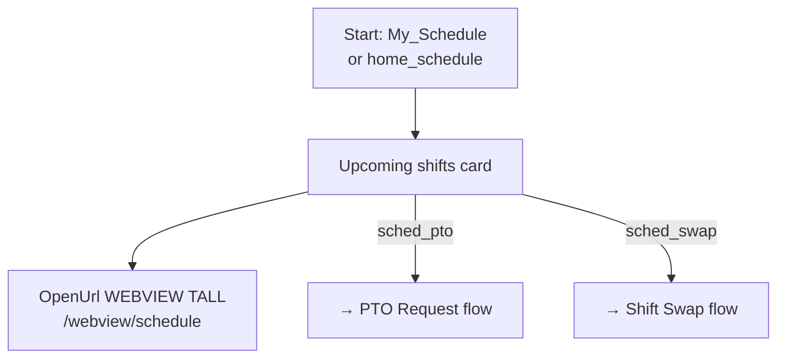

`sched_pto` and `sched_swap` are handled by an explicit `internal_jumps` map in
the adapter, because the postback prefix belongs to one flow but the handler
belongs to another.

### 4.10 Internal staff: PTO request

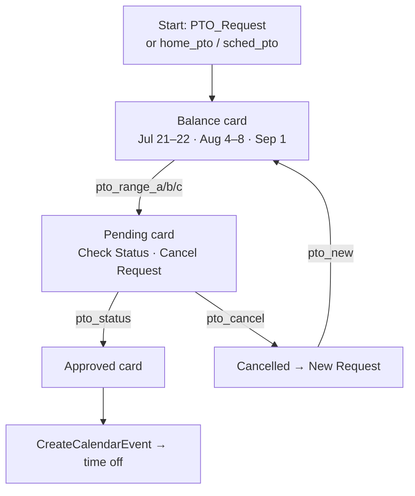

`Check Status` flipping to approved is demo theater — there's no approver
service — but it exercises the pending→resolved state transition in DynamoDB.

### 4.11 Internal staff: shift swap

The deepest deterministic flow: two chained selections encoded into one
postback.

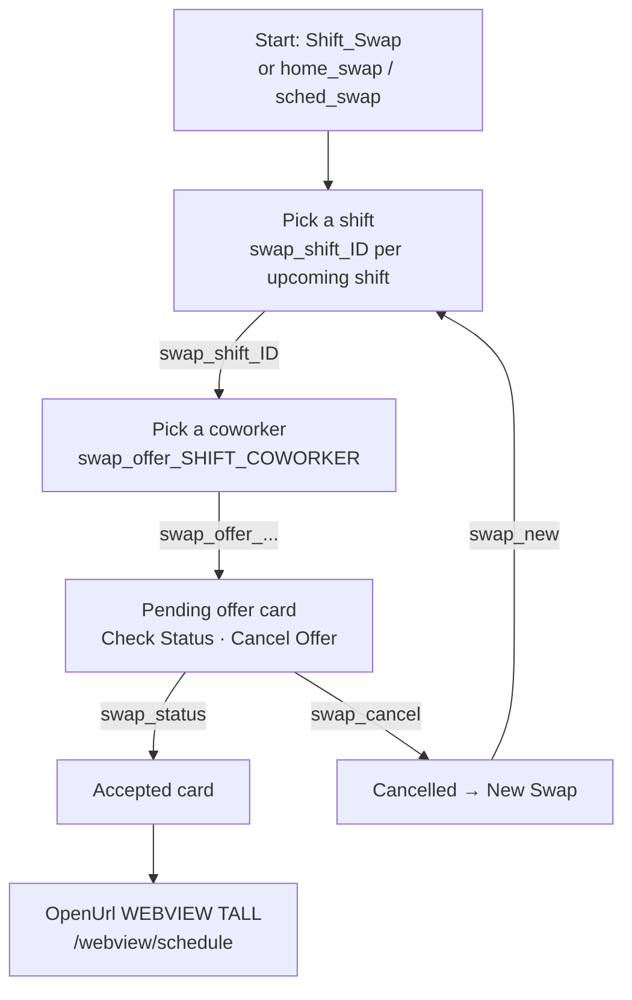

Both the shift id and the coworker id ride in the postback string
(`swap_offer_{shift}_{coworker}`) and are split apart on the way back in, which
keeps the flow stateless up to the point of submission.

### 4.12 Classify a Photo (native inbound photo)

```mermaid
sequenceDiagram
  participant M as Member
  participant E as RCS agent
  participant S as S3
  participant A as Channel Adapter
  participant C as Media Convert
  A->>M: Prompt card — "send any photo"<br/>+ Secure Upload Instead (webview) + Main Menu
  M->>E: photo
  E->>S: PutObject inbound/rcs/...
  E->>A: SNS message with mediaStatus
  A->>A: log_inbound_media + write source-key reference
  S->>C: ObjectCreated
  C->>C: normalize → JPEG, one-sentence description (Bedrock; the prompt asks it to omit personal details)
  C->>A: Invoke(Event) native_media_ready
  A->>M: "Photo Received" card with the classification
```

If the service reports any inbound `mediaStatus` other than `SUCCESS` (the card
adds a HEIC hint when the MIME type is HEIC/HEIF), the member gets a format-hint
card whose primary chip is the secure webview upload — the failure path is also
the demo of the better path.

### 4.13 Secure Document Upload (webview presigned PUT)

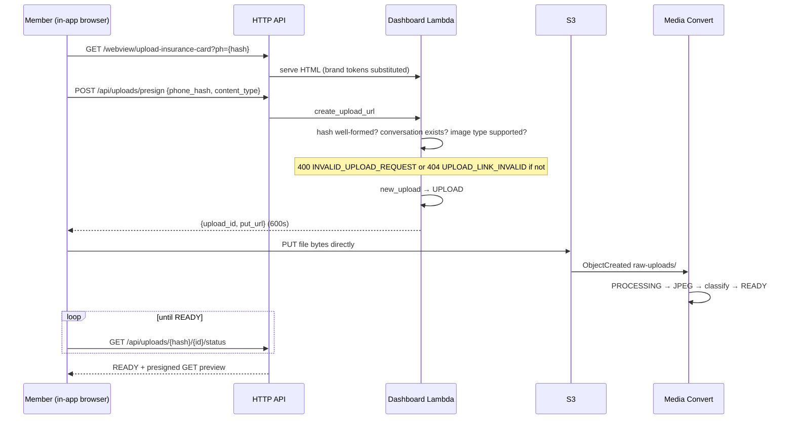

The `ph` query parameter is the hashed phone number, which is how an upload made
inside a browser session gets associated with the right RCS conversation without
the webview ever handling a phone number.

### 4.13a Loan Agreement — signable document in the webview

The outbound counterpart to Secure Document Upload. There, the member sends a
document *in*; here, the business sends one *out* to be read and signed. Both
make the same transport point: a sensitive document is kept off the RCS/carrier
network by keeping it in a webview, so only the link rides the RCS channel.

`lambda/flows/loan_agreement.py` sends a single RichCard — "Loan Agreement -
Signature Required" — whose `Review & Sign` chip is an `OpenUrl` with
`Application: WEBVIEW` and `WebviewViewMode: TALL`, pointing at
`/webview/loan-agreement`. That page (`lambda/webviews/loan-agreement.html`) is a
self-contained, no-build, three-page fake installment-loan agreement: per-page
initials (drawn, typed, or stamped), a drawn borrower signature, and on submit a
signing receipt showing a timestamp, a reference id, the masked token, and a
SHA-256 fingerprint of the document text. It makes no network calls of its own
and stores nothing — the interactivity and the signature never leave the webview.

The chip carries a `token` query parameter (`loan-{phone_hash}`) and the
recipient's `name` for personalization. As with every other webview in this demo,
**the token is a demo-level gate, not authentication** — the page only checks it
is long enough. A production signer must validate the token server- or edge-side
and bind it to the recipient (a signed URL, a member session), exactly the caveat
§3 and §4.13 make for the other unauthenticated webviews. The `_fallback_body`
degrades cleanly to SMS because the whole message is essentially the link.

### 4.14 Video Visit — WebRTC in the webview (experimental)

A two-party video call over **Amazon Chime SDK for JavaScript**, with the member
in the RCS in-conversation webview and the clinician in the operator dashboard.
Marked experimental because camera and microphone access in a webview is granted
by the messaging app that renders it, not by RCS; the `OpenUrl` fields AWS
documents are `Application` and `WebviewViewMode`.
**Confirmed working on iOS 18; Android is untested here.** The invitation card
therefore carries the `WEBVIEW`/`FULL` chip *and* a plain "Open in browser" chip
with no `Application` field — the control, and the member's recovery path if the
webview will not give up the camera.

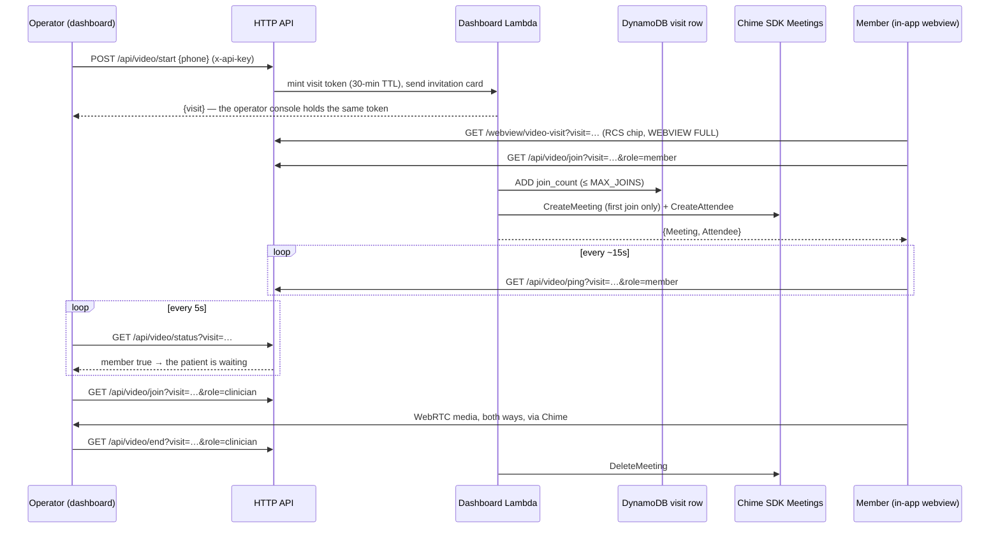

Six properties account for most of the code in
[`lambda/video_visit.py`](../lambda/video_visit.py), and every one of them is
load-bearing:

- **The token is minted at send time; the meeting is created lazily on the first
  join.** An invitation nobody opens costs nothing, and only one of the two
  clients pays the `CreateMeeting` — whichever arrives first, resolved by a
  conditional write on `attribute_not_exists(meeting)`. The loser deletes its own
  meeting and joins the winner's.
- **`/api/video/join`, `/api/video/ping`, `/api/video/status` and `/api/video/end`
  are open by design**, for the same reason as `/api/uploads/presign` and
  `/api/secure-doc`: the member's in-app browser session calls `join`, `ping` and
  `end` with no key to offer, and the dashboard's clinician view calls all four.
  `/api/video/start` and `/api/video/preview` require the key. The controls are the
  token (122-bit `uuid4`), its 30-minute TTL, and a cap on how many times it can be
  exchanged for join material.
- **`MAX_JOINS` is a spend ceiling, not a room capacity.** Chime bills per
  attendee-minute, so the number of `CreateAttendee` calls per visit is finite —
  but generous, because rejoining after a dropped connection, a page reload or a
  failed SDK load is normal. The cap counts joins, not live attendees: a cap on
  live attendees that never released a slot would lock the operator out of their
  own visit after a few retries with *"this visit already has 4 participants"*
  while the member sat in the meeting, a failure indistinguishable from broken
  WebRTC.
- **Leaving is role-scoped** (`member` | `clinician`, validated server-side). The
  clinician leaving ends the visit; the member leaving ends it only if the
  clinician is absent. This is *not* a permission model — the role arrives from an
  unauthenticated caller — it exists so the two clients' lifecycles don't fight.
  Concretely: in an iOS webview `pagehide` fires on mere backgrounding, so the
  member's page stops its heartbeat there and never calls `end()`.
- **Presence is heartbeats, not Chime.** Each side writes `seen_<role>` every ~15
  seconds and `status` reports a role present if its timestamp is within
  `PRESENCE_TTL_SECONDS` (45). That is what lets the clinician's modal say *"the
  patient is waiting"* **before** the clinician joins, when there is no local
  meeting session to query — and `status` deliberately returns booleans only,
  because the route is open.
- **The Chime SDK is vendored, not CDN-loaded.**
  [`scripts/vendor-chime-sdk.mjs`](../scripts/vendor-chime-sdk.mjs) bundles
  `amazon-chime-sdk-js` into `lambda/webviews/chime-sdk.js` (committed, generated,
  ~1.6 MB), which `dashboard_handler._serve_asset` serves gzipped and
  immutably-cached from the same route as the HTML, version-pinned by a `?v=` read
  out of the bundle's own banner. A page that asks for the camera should not let a
  third party run code in it, and the demo should not break when a CDN is
  unreachable. The package ships CommonJS only and reads Node's `global` at load,
  so both the esbuild vendor step and the dashboard's Vite config define
  `global` → `globalThis`.

Two operational notes. `chime:CreateMeeting` is granted on `*` because the meeting
does not exist yet, so there is no ARN to name; the other three actions could be
scoped to `arn:aws:chime:<region>:<account>:meeting/*`, which is the same set, so
the wildcard is honest rather than lax (see the comment in
`cdk/lib/anyhealth-stack.ts`). And **Chime SDK Meetings is not available in every
Region** — the control-plane and media Regions are separate choices, both
defaulting to the deploy Region, overridable through `CHIME_CONTROL_REGION` /
`CHIME_MEDIA_REGION` on the dashboard Lambda.

The dashboard side is `web/src/components/VideoVisitModal.tsx` (the clinician's
client) and `VideoPreviewModal.tsx` (the member's own page in a phone frame, on a
throwaway token, with no handset involved) — see §5.

**Camera & Mic Probe** is the diagnostic this use case example grew out of. It
is not in the Interactive Demos list — it lives in the dashboard's Settings tab,
under a **Diagnostics & experiments** section, because it is operator tooling
rather than a scenario you would demo to a customer. One page
(`lambda/webviews/media-probe.html`) is opened three ways from the same
message — `WEBVIEW`/`FULL`, `WEBVIEW`/`HALF`, and the device browser — reporting
`isSecureContext`, whether `getUserMedia` exists, and the exact `DOMException`
name when it fails. Run it on any handset you are curious about before concluding
the video visit is broken there; it distinguishes "this messaging app blocks
capture" from "this call failed".

### 4.15 IVS webview experiments (iCasino, Interactive Fitness)

Two experiments probe the Video Visit question from the other direction — not
"can a webview reach the camera", but "can a webview host a live **Amazon IVS**
(Interactive Video Service) app?" `lambda/flows/ivs_experiment.py` opens the
hosted IVS iCasino demo (`https://icasino.ivsdemos.com/`, real-time
betting/gaming video) and `lambda/flows/ivs_fitness_experiment.py` opens the IVS
Interactive Fitness demo (`https://fitness.ivsdemos.com/`, a low-latency stream
with a leaderboard and user interactions).

Each sends the external URL as a **top-level** `WEBVIEW` `OpenUrl` plus a
device-browser control chip. Two things matter about "top-level":

- RCS card media is a static image or video, so a card cannot *embed* a live
  page; a `WEBVIEW` `OpenUrl` opening the site is the closest thing, and it opens
  the URL as its own top-level document, not inside an `<iframe>`.
- Because it is top-level, a site's `X-Frame-Options` never applies. iCasino
  sends `X-Frame-Options: SAMEORIGIN` (it refuses to be framed); opening it
  top-level sidesteps that entirely. This is why the `OpenUrl.Url` points
  straight at the external `https` URL rather than at `c.webview_url(...)`, which
  is only for pages this API serves itself.

The browser-control chip is the same A/B as Video Visit: if the device browser
plays the stream and the webview chip does not, the messaging app's webview is
the blocker rather than the page or the network. (Neither uses the `HALF` view
mode — a half-height panel is too small for a live video app to be usable.)
Confirmed so far: iCasino plays live in an RCS webview on Android.

These two are surfaced in **both** places: named, with a send control and a
device preview, in Settings → Diagnostics & experiments; and as **Mystery Box**
cards in the Use Case Examples list — a deliberately blank card whose only
affordance is a single "." that opens a modal revealing what the box is and a
button to send it (`web/src/components/MysteryBoxModal.tsx`). The Camera & Mic
Probe (above) shares the Settings section but is not a Mystery Box.

---

## 5. Dashboard

The local Cloudscape app in [`web/`](../web/) has five tabs. Two behaviors are
worth calling out because they're not obvious from the UI, plus one that is
deliberately hard to miss:

- **Device preview** renders the exact RCS payload a use case example would send —
  cards, carousels, chips — with **zero side effects**. It calls
  `GET /api/vignettes/preview`, which builds the message without sending it or
  touching flow state. Safe to click while presenting.
- **Latest media** on the two rich-media cards is *polled* every 5 seconds
  (`GET /api/media/latest`), because a member can send a photo or finish an
  upload at any moment and there's no push channel into the dashboard.
- **The video visit is the one card whose button is not `/api/trigger`.** It calls
  `POST /api/video/start`, which sends the invitation *and* returns the visit
  token, because the dashboard has to join the same Chime meeting the handset was
  invited to (§4.14). Triggering it the ordinary way would let the flow mint its
  own token, which the dashboard never sees — both sides would then sit in
  separate, empty meetings. Joining is an explicit button on both sides rather
  than an effect: React `StrictMode` double-invokes effects, and a join creates a
  billed attendee. The modal also polls `GET /api/video/status` every 5 seconds so
  it can say **"the patient is waiting in the visit"** before the clinician joins.
- **Video preview** is the same idea as Device preview, one level deeper: it mints
  a throwaway visit token (`POST /api/video/preview`, no message sent) and loads
  the member's *real* webview in a phone frame in an `iframe`. Nothing is mocked,
  which is the point — the two things most likely to be wrong are the page's own
  permission flow and whether the SDK bundle loads, and a mockup exercises
  neither. Consequences: the frame is cross-origin (the API domain, not the
  dashboard's), so `camera; microphone` are delegated with `allow` and the browser
  prompts for *that* origin; the page mutes its own microphone on `?preview=1`,
  because the clinician client is usually open on the same machine; and dismissing
  the modal unmounts the iframe and calls `/api/video/end` so a preview cannot
  leave a meeting billing behind it.

- **Live-agent handover is escalated app-wide.** `App.tsx` polls `GET /api/mode`
  for the targeted device every 5 seconds, and when it comes back `live` it
  raises a full-bleed banner above the tab strip, flags the 2-way Conversations
  tab label, and rewrites the browser tab title. The member gets **no** reply at
  all while the conversation is in live mode, apart from an emergency message or
  a typed `menu` — the bot has stopped answering and
  `channel_adapter.process_inbound` drops every flow postback — so a handover
  the operator doesn't notice is indistinguishable from a broken demo. That poll
  is scoped to the *targeted* device; a handover on some other recipient still
  shows only as a `LIVE` marker on its row in the 2-way Conversations list.

The status bar is the one strip of persistent state, rendered at the top of
every tab (`web/src/components/StatusBar.tsx`), and reads left to right by how
often each item changes:

- **Device status lamp, then the target number, then the picker.** The lamp
  comes first deliberately: "can this device receive anything at all" is what
  explains a demo where nothing happens, so it should not be a qualifier read
  after the number.
- **Who is typing**, across every registered recipient rather than only the
  targeted one. The source is the `RCS_TYPING` inbound interaction event.
  `common.log_indicator` records it in the transcript and also refreshes a
  presence row (`SYSTEM` / `TYPING#{hash}`, `common.note_typing`) so one
  fixed-partition query answers "who is typing *now*" without scanning every
  `CONV#` partition. `GET /api/typing` returns hashes and timestamps only, never
  a phone number — the dashboard resolves the hashes to names from the tester
  list it already holds. Rows older than `common.TYPING_STALE_SECONDS` are
  filtered out, and an inbound message deletes the row outright, since a reply
  that has landed is a reply that has stopped being typed. No `RCS_TYPING` event
  was received during this sample's testing (as of 2026-09-19). The indicator is
  wired end to end and has not yet been exercised against a live event.
- **The last error**, shown here rather than in a full-width alert above the tab
  strip, which would push the whole page down and be easy to dismiss unread; here
  it sits beside the device state that usually explains it. The
  compact form is truncated; the full text is one click away in a popover.
- **An account-level RCS spend/quota warning**, cached in DynamoDB under
  `SYSTEM/RCS_QUOTA_ALERT` from `DescribeSpendLimits`.
- **The conversation mode** (bot, or a human) with its take-over/release
  control, pushed to the right but not to the margin — the versions sit beyond
  it.
- **`fe:1.0.0.18 | be:1.0.0.22`**, the build of each half. The frontend's is
  compiled in by a Vite `define`; the backend's is baked into the dashboard
  Lambda's environment at synth time and served by the open `GET /api/version`.
  Both come from `scripts/version.mjs`: the first three segments are
  hand-maintained in `version.json`, and the fourth is the number of commits
  touching that half of the tree (`web/` for the frontend, `lambda/` + `cdk/` +
  `content/` for the backend), so it advances without anyone remembering to
  bump it. A `+dev` suffix means that half was built from a dirty tree,
  `+nogit` that there was no history to count, and `be:?` that the version call
  itself failed — which is the fastest way to see that the console is pointed
  at the wrong API URL.

---

## 6. Re-theming

Nothing about the healthcare framing is structural. `content/brand.md` drives
the brand name (and therefore the resource-name prefix and the stack name),
colors, contact numbers, and the registration field values that `AGENTS.md`
reads once, at agent setup; `benefits.md`, `providers.md`, `store.md`, and
`workplace.md` supply the knowledge and catalogs the flows and the AI assistant
read. `content/*.md` is parsed at synth and staged into the Lambda assets, so a
content change plus `cdk deploy` reaches the Lambdas, the webviews, and the
dashboard. It does **not** reach the registered agent identity (logo, banner,
display name, colors, contact details): the stack has no registration resource
(the dashboard Lambda only reads the registration, for `GET /api/agent-identity`),
the registration was submitted during agent setup, and AWS notes that some brand
assets cannot be changed after submission.

Do not change `brandName` on an existing deployment. The stack id is
`<prefix>-rcs-demo` (`cdk/bin/anyhealth.ts`), where the prefix is a slug of the
brand name (`slugify` in `cdk/lib/config.ts`: lowercased, non-alphanumerics
replaced by `-`, at most 20 characters). A change that alters the slug makes
`cdk deploy` create a second stack beside the first, with its own table,
buckets, KMS key, secret, and API, and both stacks' custom resources then manage
the same agent: the new stack repoints the agent's two-way messaging at its own
topic, so the old stack stops receiving inbound messages. Destroying the old stack
afterward leaves the agent's two-way setting, its `UNSTOP` keyword and the old
configuration set in place, because the wiring Lambda's delete handler sees that
the agent now delivers to a different topic
([SETUP.md](../SETUP.md#teardown)). To deploy under a different brand name, run
`cdk destroy` on the existing stack first. See the editing table in the
[README](../README.md#editing-the-demo).
